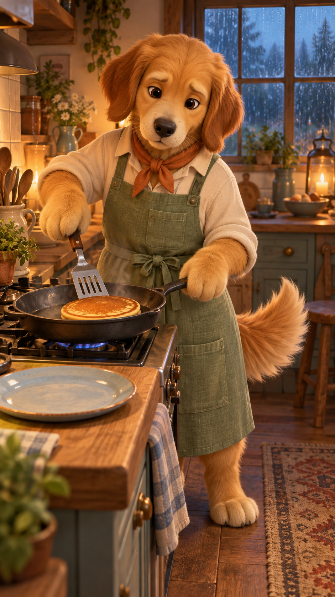

# 골든 키친 — A안 기획 샘플

리트리버가 작은 부엌에서 한 끼를 만드는 30초 요리 애니메이션.
집중할 때는 진지한 얼굴, 맛있을 때는 숨길 수 없는 꼬리로 캐릭터를 기억하게 만든다.



위 이미지는 분위기와 외형을 보는 콘셉트 초안이다. 캐릭터 시트나 최종 키프레임은 아니다.
세부 의상은 제작용 시트에서 확정한다. 예를 들어 콘셉트의 앞쪽 허리 매듭은 기획안의 뒤쪽 매듭으로 통일할 예정이다.

## 첫 편: 비 오는 날의 팬케이크

| 시간 | 화면 | 보는 재미 |
|---|---|---|
| 0–5초 | 팬에 반죽이 동그랗게 퍼진다 | 시작부터 주르륵·치익 |
| 5–10초 | 조심스럽게 팬을 보는 리트리버 | 진지한 얼굴과 흔들리는 꼬리 |
| 10–15초 | 반죽 기포가 톡톡 터진다 | 음식 클로즈업과 조리 소리 |
| 15–20초 | 팬케이크를 한 번 뒤집는다 | 노릇한 면이 드러나는 순간 |
| 20–25초 | 접시에 담아 과일 퓌레를 두른다 | 따뜻한 색과 질감 |
| 25–30초 | 한 입 먹고 눈을 감는다 | 꼬리 두 번, 짧은 여운 |

대사 없이 빗소리와 조리 ASMR로 진행한다. 색은 꿀빛 털·세이지 앞치마·주황 스카프, 공간은 나무 부엌과 비 오는 창문으로 고정한다.

## 같은 캐릭터로 이어갈 소재

| 후속 편 | 중심 동작 | 마지막 장면 |
|---|---|---|
| 단호박 수프 | 주황색 수프를 천천히 젓는다 | 머그를 두 앞발로 감싸고 김을 바라본다 |
| 주먹밥 도시락 | 밥을 꾹꾹 눌러 모양을 잡는다 | 완성한 세 알을 보고 꼬리를 흔든다 |
| 고구마 타르트 | 으깬 고구마를 타르트에 채운다 | 바삭한 단면을 보여 주고 만족스러운 표정 |

[상세 컷표·캐릭터 락·음향 설계](01-기획안.md)

## 콘셉트 이미지 생성 기록

- 도구: 내장 image_gen (CLI/API 대체 경로 사용 안 함).
- 용도: 기획 콘셉트 확인용 이미지 1장.
- 파일: `00-콘셉트샘플.png`.
- 최종 프롬프트:

```text
Use case: stylized-concept. Create a single beautiful vertical 9:16 concept illustration preview for an original cozy cooking animation. One anthropomorphic golden retriever chef with honey-gold fur, slightly darker floppy ears, cream muzzle, rounded black nose, warm dark brown eyes, gentle serious focused expression, soft rounded cheeks, one fluffy tail visible. Wearing a sage green linen apron with square pocket, cream rolled sleeve shirt, small rust orange neckerchief. Rounded paw hands, not human hands. The retriever is carefully cooking one golden pancake with a spatula in a dark gray skillet, at a cottage kitchen stove. Rainy cool blue window behind and warm amber interior, wood counters, creamy tiles, pale blue ceramic plate waiting beside stove. Soft tactile original 3D animated movie aesthetic, matte fur, appetizing food, delicate steam, sophisticated warm lighting, endearing but not babyish, strong clear composition for a short vertical film. Keep entire head, apron, skillet and visible tail within frame. No text, no logos, no watermark, no additional characters. This is a planning concept preview, not a final animation frame.
```
