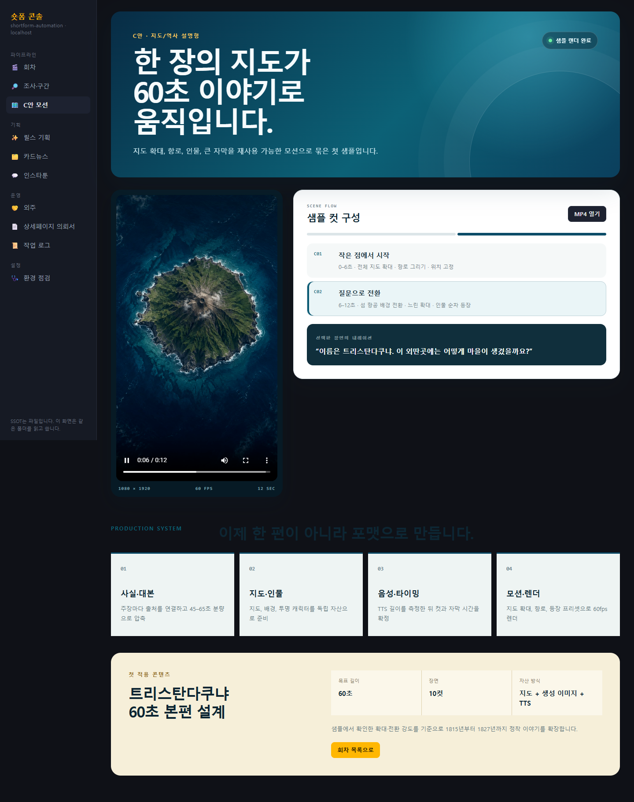
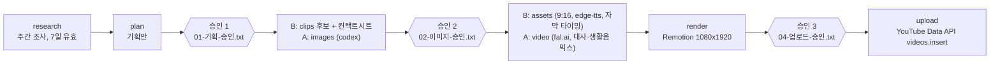

# 숏폼 자동화 (shortform-automation)

유튜브 쇼츠 제작을 조사, 기획, 소재, 렌더, 업로드 준비까지 잇는 로컬 우선 Python 파이프라인과 Next.js 운영 콘솔

상태: 개발 중 (로컬 운영, 배포 없음) · 2026-09-08 ~ 2026-10-06 · 1인 개발, 구현은 AI 에이전트 협업

    

## 데모

라이브 링크 없음(로컬 `http://localhost:3123`). 아래는 A안 렌더 결과 1프레임으로, AI 생성 이미지 위에 Remotion 자막 카드를 얹은 1080x1920 영상이다.


<table><tr>
<td><br>회차 목록과 단계 진행</td>
<td><br>C안 12초 샘플과 컷 구성</td>
</tr></table>


## 무엇을 해결하나

숏폼 한 편은 조사, 대본, 소재 확보, 자막, 렌더, 업로드로 이어지는 반복 작업이고, 단계마다 도구와 파일이 흩어져 상태를 놓치기 쉽다.
이 프로젝트는 단계를 폴더 규약과 CLI로 묶고, 사람이 판단할 지점 3곳(기획, 소재, 업로드)만 승인 파일로 남긴다.

## 핵심 기능

- **승인 게이트 3개**: 승인 파일이 없으면 해당 단계에서 멈추고 종료 코드 2를 낸다.
- **조사 게이트**: 주간 조사 리포트가 없거나 7일을 넘으면 기획 단계가 실행되지 않는다.
- **구간 후보 추출**: 롱폼 1편에서 ffmpeg 음량 신호와 yt-dlp 자막으로 후보를 뽑고, 고르는 일은 사람이 한다.
- **화면 템플릿 3종**: 브리핑 포커스(TTS 내레이션), 화이트·블랙 피드 카드(원음 유지). 템플릿이 내레이션 방식을 정한다.
- **두 제작 트랙**: B안은 클립 재편집, A안은 Codex 이미지에서 fal.ai 영상 생성으로 이어지며 편당 비용 상한(10달러)을 둔다.
- **음성**: edge-tts가 기본이고, 로컬 GPU의 Qwen3 TTS를 음성 스튜디오 화면에서 비교·적용할 수 있다.
- **웹 콘솔**: 회차 목록, 기획안 편집, 클립 선택, Remotion Player 미리보기, 타임라인 편집, 잡 실행 로그(SSE).
- **게시**: YouTube Data API 직접 업로드, Buffer 경유 3플랫폼 게시 CLI(영상 SHA256 기반 중복 방지).

## 아키텍처



- 파일이 단일 진실의 원천이다. DB가 없고 웹 콘솔은 같은 폴더를 읽고 쓴다. 읽기는 `shortform inspect` JSON 브리지를 거쳐 파서를 TS로 복제하지 않는다.
- 단계 완료는 편 폴더의 `상태.json`에 기록해 재실행 시 건너뛴다. `--force`로 다시 실행한다.
- 업로드는 재시도하지 않는다. 같은 영상이 두 번 올라가는 쪽이 한 번 실패하는 쪽보다 나쁘다는 판단이다.
- python·claude·codex·fal 호출은 잡 러너를 거쳐 로그를 남긴다(LLM은 API 키 대신 로컬 `claude -p` / `codex exec` spawn). 업로드와 fal 과금 API는 `confirmed: true` 없이는 거부한다.
- 파일 접근 API는 `lib/safePath.ts`(저장소 밖, `pipeline/secrets`, `.env`, `.git` 거부)를 모두 통과한다.

## 검증과 수치

| 항목 | 값 | 근거 |
|---|---|---|
| 커밋 | 56개, 마지막 2026-10-06 | `git rev-list --count HEAD`, `git log -1` |
| Python 코드 | 53파일, 8,371줄 | `pipeline/shortform` 아래 `*.py`, `wc -l` |
| 웹 콘솔 | 화면 26, API 라우트 51 | `pipeline/web/app`의 `page.tsx`, `route.ts` 수 |
| Python 테스트 함수 | 194개 (17파일) | `grep -E "def test_" pipeline/tests` |
| JS 테스트 | 웹 21개 통과, Remotion 계약 6개 통과 | `npm test -w web`, `node --test remotion/tests/template-contract.test.mjs` (2026-10-19) |
| Python 테스트 실행 | 13파일 통과, 2파일 8건 실패, 1파일 미완, 1파일 skip | 파일별 `pytest` (2026-10-19, 9초 제한). 상세는 상태와 한계 |
| 제작 회차 | 폴더 16개, 완성 mp4 7개 (B 5, A 1, C 샘플 1) | `2026-*/[ABC]-*`, `04-영상/` (영상은 Git 제외) |
| A안 비용 상한 | 편당 10달러 | `pipeline/config/fal-chain.yaml` |

## 빠른 시작

요구 사항: Windows, Python 3.10, Node.js(확인한 버전 22, 24), ffmpeg·ffprobe(PATH), Qwen3 음성은 NVIDIA GPU.

```powershell
cd pipeline
py -3.10 -m venv .venv
.venv\Scripts\python -m pip install -r requirements.txt
npm install            # 워크스페이스: remotion + web
npm run dev            # http://localhost:3123
```

한글 경로에서는 `pip install -e .`를 쓰지 않는다. site-packages의 `.pth`를 cp949로 읽다가 파이썬이 죽는다. `pipeline` 폴더에서 직접 실행한다.

```powershell
.venv\Scripts\python -m shortform research
.venv\Scripts\python -m shortform segments --source <URL> --date <YYYY-MM-DD>
.venv\Scripts\python -m shortform new --track B --date <YYYY-MM-DD> --episode 01 --slug <제목>
.venv\Scripts\python -m shortform run --track B --date <YYYY-MM-DD> --episode 01   # 승인 대기 시 종료 코드 2
```

종료 코드: 0 정상, 1 실패, 2 승인 대기, 3 API 키 없음. 승인은 편 폴더에 빈 승인 파일을 만들면 통과한다.

키는 `pipeline/.env`에 둔다(Git 제외). 웹 콘솔의 환경 점검 메뉴가 빠진 항목을 보여 준다. YouTube 업로드는 `pipeline/secrets/client_secret.json`(OAuth 데스크톱 클라이언트)이 따로 필요하고, 이 폴더는 공유하지 않는다.

| 이름 | 용도 | 예시 |
|---|---|---|
| `YOUTUBE_API_KEY` | discover (YouTube Data API v3) | `<발급받은 키>` |
| `PEXELS_API_KEY` | B안 stock 소재 | `<발급받은 키>` |
| `FAL_KEY` | A안 영상 생성(과금) | `<발급받은 키>` |
| `NAVER_CLIENT_ID`, `NAVER_CLIENT_SECRET`, `NAVER_AD_*` | 블로그 검색 API, 선택: 검색광고 키워드 검색량 | `<발급받은 값>` |
| `BUFFER_API_KEY`, `R2_*`(계정·버킷·액세스 키·공개 URL) | `publish` 명령, 원격 아카이브 업로드 | `<발급받은 값>` |

테스트(pytest는 `requirements.txt`에 없어 따로 설치): `.venv\Scripts\python -m pytest tests`, `npm test -w web`, `node --test remotion/tests/template-contract.test.mjs`

## 프로젝트 구조

```text
shortform-automation/
├── docs/             설계, 전략, 작업기록, PDCA 문서, 검증 캡처
├── pipeline/
│   ├── shortform/    단계 모듈(steps), TTS, 블로그, 스튜디오, 게시
│   ├── remotion/     영상 컴포지션, 템플릿 계약 테스트
│   ├── web/          Next.js 로컬 운영 콘솔
│   ├── tts-service/  Qwen3 음성 엔진 설치·검증 안내
│   ├── config/       채널·템플릿·음성·비용 설정(yaml)
│   └── tests/        pytest 17파일
├── viewer/           Cloudflare Pages 원격 아카이브 뷰어
├── .claude/plans/    작업 계획과 게이트 기록
├── YYYY-MM-DD/       날짜별 회차 문서와 컨택트시트
└── 릴스기획/ 외주/ 블로그/ 인스타툰/ 카드뉴스/   부가 작업실 산출물
```

다운로드 원본, 렌더 결과, 큰 미디어는 Git에 올리지 않는다. 기획안, 승인 파일, 컨택트시트, 클립 목록만 버전 관리한다.

## 개발 방식

- 설계, 승인 기준, 최종 리뷰는 직접 한다. 구현은 Claude Code, Codex에 위임하고, 작업 계획(난이도 점수, 모델 배정, 게이트 검사)을 `.claude/plans/*.plan.json`(12개)에 남긴다.
- 한술툰 작업실은 bkit PDCA 문서로 진행했다: `docs/01-plan/features/`, `docs/02-design/features/`, `docs/03-analysis/`, `docs/04-report/features/`. 큰 기능의 구현 계획서는 `docs/superpowers/plans/`, 결정과 삽질은 [docs/00-작업기록.md](docs/00-작업기록.md)에 있다.

## 문서

| 알고 싶은 것 | 문서 |
|---|---|
| 파이프라인 설계, 두 트랙과 공통 원칙 | [설계](docs/설계/00-파이프라인-설계.md), [전략 개요](docs/전략/00-개요.md) |
| B안 운영, 템플릿 규격 | [10-B안-예능클립](docs/전략/10-B안-예능클립.md), [11-템플릿-규격](docs/전략/11-템플릿-규격.md) |
| A안, C안 | [20-A안-AI생성-영상](docs/전략/20-A안-AI생성-영상.md), [10-A안-체인-키프레임](docs/설계/10-A안-체인-키프레임-스토리보드.md), [02-C안-모션숏폼](docs/설계/02-C안-지식역사-모션숏폼.md) |
| Qwen3 음성, Take Studio | [03-음성스튜디오](docs/설계/03-Qwen3-TTS-음성스튜디오.md), [검증 기록](pipeline/tts-service/VALIDATION.md), [08-Take-Studio-구현-검증](docs/설계/08-Take-Studio-구현-검증.md) |
| 3플랫폼 게시, 원격 아카이브 | [30-멀티플랫폼-게시](docs/전략/30-멀티플랫폼-게시.md), [40-원격-아카이브-뷰어](docs/40-원격-아카이브-뷰어.md) |
| 네이버 블로그 자동화 | [04-설계](docs/설계/04-네이버블로그-자동화.md), [05-보안검토](docs/설계/05-네이버블로그-보안검토.md) |
| 단계별 실행법, 웹 콘솔, 구현 변경 목록 | [pipeline/README.md](pipeline/README.md), [pipeline/web/README.md](pipeline/web/README.md), [90-구현-변경목록](docs/전략/90-구현-변경목록.md) |

## 상태와 한계

- **업로드 미검증**: 8개 회차 `상태.json` 어디에도 `upload` 단계 완료 기록이 없다. `videos.insert` 경로는 구현만 되어 있고 실업로드 성공을 이 저장소에서 확인하지 못했다.
- **Buffer 게시**: 가짜 API 테스트로 검증했다. 문서는 첫 실게시 검증이 남았다고 적지만 결과 파일에는 `sent` 12건이 있어 서로 어긋난다. 확인 필요.
- **실패하는 테스트 8건**: `test_generation_quality.py` 6건, `test_qwen_tts.py` 2건. 코드 변경을 테스트가 따라가지 못한 것으로 보이며 원인은 확정 전이다. `test_r2.py`는 9초 안에 끝나지 않아 결과를 못 봤다.
- **B안 소재는 외부 영상 클립 인용이다.** 저작권이 살아 있어 Content ID 클레임과 수익화 제한 가능성을 알고 쓰는 선택지다. 출처 표기는 사용 허락을 대신하지 않는다. Content ID 회피 목적의 화면 변형은 만들지 않으며, 공개 업로드는 사람이 최종 결정한다.
- **C안**은 12초 60fps 샘플과 `/c-motion` 소개 화면까지다. 60초 본편, C 회차 파이프라인 연결, `--track C`는 없다.
- 자막 어절 타이밍은 추정치다. edge-tts 7.2.8은 `WordBoundary`를 주지 않아 문장 구간만 정확하고 어절 위치는 글자 수 비례로 나눈다.
- 자동 소재 검색은 Pexels stock만 붙어 있다. `pd`, `trailer` 소재는 `03-소재/클립/NN.mp4`에 직접 넣는다. BGM 덕킹(대사 구간 BGM 감쇠)은 없고 BGM은 고정 볼륨이다.
- 블로그는 사람이 붙여넣는 `copy`가 기본이다. 브라우저 임시저장 `draft`는 설정에서 따로 켜야 하며 자동 발행은 구현하지 않았다.
- Take Studio는 빌드와 HTTP 검증까지 마쳤고 브라우저 클릭·좁은 화면·100노드 성능은 미확인이다. 유료 Codex/fal 호출과 GPU 음성 생성은 모의 응답으로만 검증했다.
- 다음 단계: 3플랫폼 첫 실게시 검증, 실패 테스트 정리, C안 60초 본편, BGM 덕킹.

## 라이선스 / 연락처

All rights reserved (개인 프로젝트).
GitHub: [jooho1003](https://github.com/jooho1003) · 이메일: tjrwn1003@gmail.com
