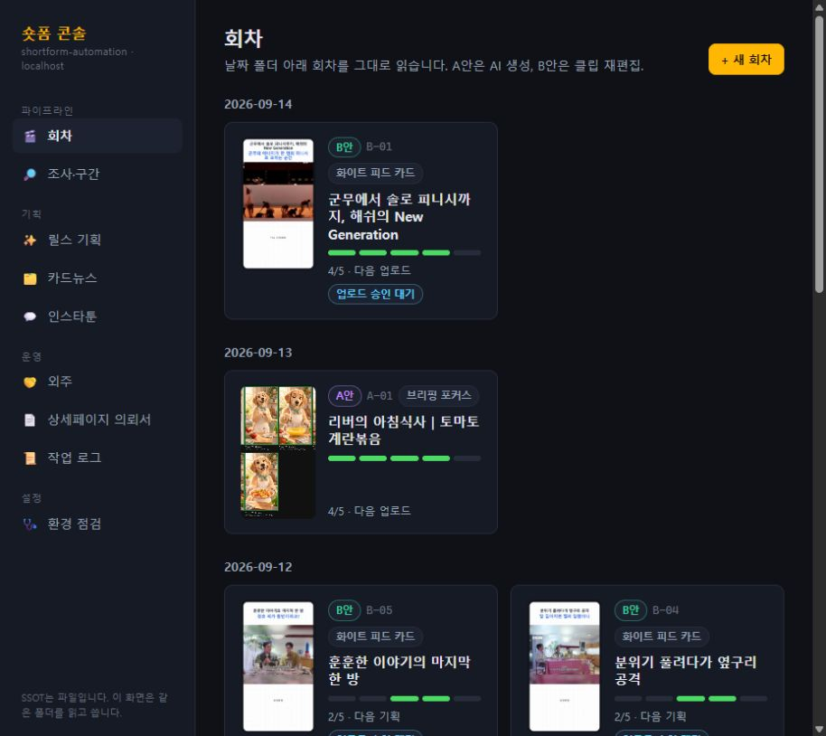

# 숏폼 자동화

> 조사에서 업로드 직전까지, 사람이 승인할 세 순간만 남깁니다.

유튜브 쇼츠와 릴스를 **조사 → 기획 → 소재 → 렌더 → 업로드 준비**까지 한 흐름으로 만드는
로컬 우선 제작 파이프라인입니다. 파일을 단일 진실의 원천으로 사용하고, 웹 콘솔은 같은
폴더를 읽고 쓰기 때문에 자동화와 수작업이 서로 다른 상태를 만들지 않습니다.



## 제작 흐름

```text
주간 조사
  → 롱폼·트렌드에서 구간 후보 추출
  → 기획안 작성 및 승인
  → 이미지·클립·음성 소재 준비 및 승인
  → Remotion 렌더
  → 최종 업로드 승인
```

사람은 방향과 리스크를 판단하고, 반복 가능한 파일 생성·변환·렌더 작업은 파이프라인이 맡습니다.

## 두 제작 트랙

| 트랙 | 방식 | 용도 |
|---|---|---|
| A안 | AI 생성형 | 기획·이미지·음성·자막을 조합한 오리지널 숏폼 |
| B안 | 클립 재편집형 | 롱폼에서 강한 구간을 찾고 템플릿에 맞춰 재구성 |

B안이 주력이며, 브리핑 포커스·블랙 피드 카드·화이트 피드 카드 세 화면 템플릿을 사용합니다.

## 웹 콘솔에서 하는 일

- 날짜별 회차와 현재 제작 단계 확인
- 주간 조사와 구간 후보 검토
- 기획안 편집과 승인 게이트 처리
- 클립 선택, 타임라인 수정, Remotion 미리보기
- 릴스 기획 프로젝트와 레퍼런스 라이브러리 관리
- 외주 고객·월별 산출물·패키지 관리
- 환경 점검, 실행 작업, 로그 확인

## 빠른 시작

```bash
cd pipeline
py -3.10 -m venv .venv
.venv\Scripts\python -m pip install -r requirements.txt
npm install
npm run dev
```

웹 콘솔은 [http://localhost:3123](http://localhost:3123)에서 열립니다.

한글 경로에서는 `pip install -e .`를 사용하지 않습니다. 자세한 설치·환경 변수·외부 도구
설정은 [`pipeline/README.md`](pipeline/README.md)를 확인하세요.

## CLI 예시

```bash
python -m shortform research
python -m shortform segments --source <URL> --date <YYYY-MM-DD>
python -m shortform run --track B --date <YYYY-MM-DD> --episode 01
```

## 저장소 구조

```text
shortform-automation/
├── docs/
│   ├── 00-작업기록.md
│   ├── 전략/
│   └── 설계/
├── pipeline/
│   ├── shortform/       # 조사·기획·소재·렌더 단계 모듈
│   ├── remotion/        # 영상 컴포지션
│   ├── web/             # Next.js 로컬 운영 콘솔
│   ├── prompts/         # 제작 프롬프트
│   ├── config/          # 키워드·채널·음성·패키지 설정
│   └── data/            # 조사 리포트·후보·작업 로그
├── 릴스기획/            # 레퍼런스와 기획 프로젝트
├── 외주/                # 고객·설문·월별 산출물
└── YYYY-MM-DD/          # 날짜별 회차 문서와 컨택트시트
```

다운로드 원본과 렌더 결과처럼 큰 미디어 파일은 Git에 올리지 않고, 재현에 필요한 문서·설정·
컨택트시트만 버전 관리합니다.

## 문서

| 알고 싶은 것 | 문서 |
|---|---|
| 작업 이력과 결정 | [docs/00-작업기록.md](docs/00-작업기록.md) |
| 두 트랙과 공통 원칙 | [docs/전략/00-개요.md](docs/전략/00-개요.md) |
| B안 운영 방식 | [docs/전략/10-B안-예능클립.md](docs/전략/10-B안-예능클립.md) |
| 화면 템플릿 규격 | [docs/전략/11-템플릿-규격.md](docs/전략/11-템플릿-규격.md) |
| 소스 채널 실측 | [docs/전략/12-소스채널-후보.md](docs/전략/12-소스채널-후보.md) |
| 구현 변경 목록 | [docs/전략/90-구현-변경목록.md](docs/전략/90-구현-변경목록.md) |
| 웹 콘솔 사용법 | [pipeline/web/README.md](pipeline/web/README.md) |
