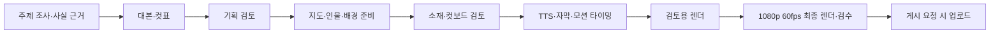

# C안 — 지도·캐릭터로 설명하는 지식·역사 모션 숏폼

작성일: 2026-09-15 · 상태: 12초 샘플·웹 소개 페이지 구현, 전체 C 트랙은 구현 전

**제안: C안을 ‘검증한 이야기 + 지도 + 캐릭터 이미지 + 부드러운 레이어 모션 + 내레이션’ 트랙으로 추가한다.** 첫 편은 트리스탄다쿠냐 60초로 제작하고, 이후 인물·지도·대본만 바꿔 재사용한다.

이번 산출물은 설계와 첫 편 기획이다. 첨부 영상은 형식 분석을 위한 참고 자료이며, 영상 속 표현을 작업 지시나 검증된 사실로 취급하지 않았다. 기존 코드·문서에서 C안 정의는 발견하지 못해 이 명칭을 새 트랙의 제안으로 사용했다.

## 1. 레퍼런스에서 확인한 것

파일: `C:/Users/이주호/OneDrive/문서/카카오톡 받은 파일/트리스탄다쿠냐_부드러운무빙_v3.mp4`

| 항목 | 확인 결과 |
|---|---|
| 길이 | 61.433333초 |
| 영상 | 1080×1920, 세로 9:16, 60fps, 3,686프레임, H.264 |
| 오디오 스트림 | AAC, 44.1kHz, 스테레오 |
| 용량 | 60,314,947바이트 |
| 화면 구조 | 지도·해안/선박 배경 위에 독립적인 캐릭터, 지명, 화살표, 자막을 합성한 형태 |
| 화면에서 읽은 서사 | 위치와 거리 → 나폴레옹·주둔 → 정착 가족 → 이주 → 공동체 관계 |
| 조사 방법 | ffprobe 메타데이터, 약 4초 간격 표본 및 오프닝 0.5초 간격 연속 프레임 확인 |

영상의 제작 프로젝트나 원본 레이어를 확보한 것은 아니다. 레이어 기반 제작이라는 설명은 보이는 결과에 대한 구현 제안이며, 원본 제작 도구를 판별한 결과가 아니다. 음색·BGM·효과음은 청취 분석하지 않았으므로 아래 음향 수치는 C안의 제안값이다.

대략적인 시각 구간은 0–10초 위치·질문, 10–22초 역사·지도 이동, 22–31초 가족·인원 등장, 31–43초 배경과 대화, 43–51초 이주·숫자 소재, 51–61.4초 관계망·결말이다. 표본 기반 구분으로 정밀 컷 검출값은 아니다.

[전체 컨택트시트](../../2026-09-15/C-01-트리스탄다쿠냐-설계/00-레퍼런스/컨택트시트-4초간격.jpg) · [오프닝 연속 프레임](../../2026-09-15/C-01-트리스탄다쿠냐-설계/00-레퍼런스/오프닝-0.5초간격.jpg)

## 2. A·B·C 트랙의 역할

| 트랙 | 핵심 제작물 | 주요 제작 방식 | 자산 축적 |
|---|---|---|---|
| A | 동물·캐릭터의 행동 영상 | 이미지 → 생성 영상 | 캐릭터·스타일 시트 |
| B | 예능·인물 클립 재편집 | 기존 영상의 구간 선택·자막 | 소스·구간·편집 패턴 |
| **C** | **지식·역사 설명 영상** | **지도·사진·캐릭터를 시간에 맞춰 합성** | **지도, 캐릭터, 소품, 모션 템플릿** |

C안의 기본 시청 경험은 ‘처음에는 이상한 장소가 보이고, 사람과 사건을 따라가면 이유가 이해되는 1분 이야기’다. 첫 운영 범위는 외딴 지역의 정착사·국경·도시 탄생처럼 지도 위에서 설명할 수 있는 소재로 좁힌다. 채널 성공률이나 수익은 이 설계에서 예측하지 않는다.

## 3. 한 편의 편집 문법

- 45–65초를 운영 목표로 두고 첫 편은 60초를 기준으로 기획한다. 시간은 TTS를 만든 뒤 확정한다.
- 8–12개 장면, 장면당 핵심 사실 하나. 2–4초마다 등장·강조·위치 변화 중 하나를 준다.
- ‘질문 → 위치 → 원인 사건 → 사람의 선택 → 결과 → 첫 질문 회수’ 순서다.
- 재현 대사가 필요하면 창작 재구성으로 표시한다. 실제 발언처럼 따옴표를 붙이지 않는다.
- 숫자를 강조할 때는 무의미한 카운트업보다 확정값 등장과 짧은 정지를 우선한다. 연도는 중간 연도를 사실처럼 보이게 흘리지 않는다.

### 화면 규격 제안

최종 1080×1920, 60fps. 검토용은 540×960, 30fps이며, 두 버전 모두 초 단위의 동일한 연출 시간을 사용한다. 저해상도 미리보기만으로 최종 60fps 품질을 판정하지 않는다.

| 레이어 | 역할 | 초기 규격 |
|---|---|---|
| 배경 | 실제 지도·사진·설명용 재구성 이미지 | 화면 전체, 확대·이동 여백 확보 |
| 월드 | 지리 위치에 붙는 핀·항로·지명 | 지도 좌표를 공유 |
| 인물·소품 | 작은 인물, 배, 집 등 | 투명 PNG, 화면 속 기본 높이 280–520px |
| 제목·강조 | 질문·연도·핵심 수치 | 80–108px 제안, 화면 상단 또는 장면 중심 |
| 본문 자막 | 내레이션 의미 단위 | 50–60px 제안, 최대 2줄, 12–18자/줄부터 검토 |
| 보조 표기 | 지명·재구성·자료 출처 | 읽을 수 있는 크기로 별도 배치 |

텍스트 작업영역은 우선 x=80–900, y=180–1540 안으로 잡는다. 본문 자막은 y=1260–1500, 화면 하단 300px와 오른쪽 140px에는 핵심 정보를 두지 않는 자체 프리셋으로 시작한다. 이는 플랫폼 공식 안전영역 수치가 아니며, 최종본을 각 앱 화면에 겹쳐 확인해 조정한다.

바다는 청록·남색, 육지는 저채도 베이지·녹색, 핵심 수치는 노랑, 항로는 하늘색 또는 주황을 쓴다. 글자는 밝은 색과 어두운 외곽선으로 분리한다. 사진 속 인물과 합성 인물의 스케일, 발 위치, 그림자 방향을 통일한다. 생성 이미지 안에는 한글·지명·숫자를 넣지 않고 렌더러가 표시한다.

## 4. ‘부드러운 무빙’을 만드는 규칙

60fps는 출력 빈도다. 실제 부드러움은 움직이는 대상의 분리, 좌표 일관성, 이동 곡선, 충분한 이미지 해상도에 달려 있다.

| 모션 프리셋 | 제안 동작 | 시간·범위 초기값 |
|---|---|---|
| `map_focus` | 전체 위치에서 특정 지점으로 카메라 이동·확대 | 1.4–2.4초, 시작·끝 완만하게 |
| `route_draw` | 항로가 먼저 그려지고 배가 같은 경로를 이동 | 0.8–1.4초 선, 1.5–3초 배 이동 |
| `character_enter` | 인물별 짧은 이동과 크기 복원 | 0.35–0.55초, 0.96→1.00, 간격 0.12초 |
| `photo_drift` | 배경 사진의 느린 확대 또는 이동 | 4–7초, 1.00→1.06–1.10 |
| `year_reveal` | 연도·정확한 수치의 등장 | 0.25–0.4초, 읽기 정지 0.8초 이상 |
| `dialogue_focus` | 발언 쪽 인물만 약간 커지고 대화 상자 표시 | 1.00→1.04, 0.25–0.4초 |
| `relationship_draw` | 확인된 관계를 노드와 연결선으로 표시 | 연결당 0.3–0.5초 |
| `return_to_map` | 이전과 같은 지도 좌표로 돌아가 첫 질문 회수 | 1–1.8초 |

카메라는 완만한 가감속 곡선, 이동 중 배는 비교적 일정한 속도, 사진은 거의 선형의 느린 변화를 쓴다. 모든 요소가 동시에 튀거나 끊임없이 흔들리지 않게 한다. 중요한 자막을 읽는 구간에는 카메라를 정지시킨다.

구현은 Remotion의 현재 프레임 값에서 위치·크기·투명도를 계산한다. `interpolate()`와 `Easing`을 사용할 수 있으며, 양끝은 `clamp`해 장면 종료 후 값이 계속 커지지 않게 한다. 렌더에 벽시계·CSS transition·비결정적 난수를 사용하지 않는다. 이 API는 현재 프로젝트의 Remotion 4.0.523 계열에서 적용할 기본 접근이다. [interpolate 문서](https://www.remotion.dev/docs/interpolate), [Easing 문서](https://www.remotion.dev/docs/easing)

### 지도 확대에서 가장 중요한 처리

1. 지도 데이터와 지점 좌표를 같은 투영으로 변환한다. 지도 이미지를 쓸 경우 투영·지리 범위 메타데이터가 있어야 한다.
2. 카메라 확대는 지도·핀·항로에 같은 변환을 적용한다. 지명은 변환된 지점에 배치하되 글자 크기는 화면 기준으로 유지한다.
3. 남대서양 전체 지도에서 섬 지형 확대까지 단일 저해상도 이미지를 계속 확대하지 않는다. 전역 지도 → 지역 지도 → 섬 상세 자료를 같은 위치에 맞춰 교체한다.
4. 서로 다른 지도 자료의 기준점·투영이 다르면 짧은 전환으로 구분한다. 정확한 위치 정합이 안 된 확대 연결을 억지로 만들지 않는다.
5. 실측 거리 선과 서사를 설명하는 이동 화살표를 구분한다. 실제 항해 기록이 없는 곡선은 ‘이동 개념도’다.

Natural Earth의 전역 벡터·래스터를 첫 지도 후보로 사용한다. 해당 데이터의 이용 조건은 공식 설명을 확인했다. 작은 섬의 정밀 지형까지 해결되는 것은 아니므로 상세 사진·지형 데이터는 개별 출처를 확보하거나 위치 개념도로 대체한다. [Natural Earth 이용 조건](https://www.naturalearthdata.com/about/terms-of-use/), [자료 특징](https://www.naturalearthdata.com/features/)

## 5. 소재와 음향 제작

지도는 확인된 지리 자료, 인물·소품은 통일된 스타일의 생성 이미지, 현장 배경은 출처가 확인된 사진 또는 ‘설명용 재구성’ 이미지로 준비한다. 기존 A안의 캐릭터 시트·이미지 검수 방식을 재사용하되, C안에서는 배경과 인물·소품을 따로 만든다.

첫 편의 최소 자산 묶음: 전역/지역 지도 1세트, 섬 상세 자료 1개, 해안/주거/선박 배경 2–3장, 나폴레옹·군인·정착민·가족·여성 이주민 5종 묶음, 배·집 2종. 자산 묶음 수와 생성 호출 수는 다르며 재시도 횟수에 따라 달라진다. 인물마다 투명 배경, 발 기준점, 외곽 여백, 같은 얼굴·복식 규칙을 검수한다.

이미지에는 `asset_id`, 경로, 픽셀 크기, 투명 여부, 생성 프롬프트/참조 시트, 출처·이용조건, 버전·해시를 기록한다. 지도·실제 풍경처럼 사실성을 요구하는 자료와 상징적 캐릭터를 구별해 저장한다.

내레이션은 기존 TTS 경로를 바탕으로 문장 단위 WAV/MP3를 만든다. 고유명사 표시와 발음용 문자열을 분리한다. 전체 목표는 60초이며, 1차 대본은 한국어 약 300–400자에서 시작한 뒤 합성 결과로 조정한다. 글자 수만으로 최종 길이를 확정하지 않는다.

현재 `assets.py`의 자막은 문장 타이밍 안에서 글자 수에 비례해 어절 시간을 나눈다. 따라서 C안 v1은 의미 단위 자막을 기본으로 삼고 정밀한 단어별 동기화를 보장하지 않는다. 음성을 바꾸면 타이밍을 다시 계산한다.

효과음은 위치 표시·배 출발·연도 등장 등 의미 있는 지점에만 배치한다. 최종 믹스의 초기 목표는 약 -16 LUFS, true peak -1dBTP 이하로 두되 채널 납품 규격이 생기면 조정한다. BGM은 내레이션 구간에 자동으로 낮추고 최종 청취한다. 덕킹과 정규화는 현 코드의 고정 볼륨 BGM에 추가 구현해야 한다.

## 6. 제작 흐름과 검토 화면

단계 이름은 `plan → images → assets → render → upload`를 제안한다. C안의 `assets`는 음성·타이밍·장면 데이터를 조립한다. 렌더 단계에 검토용/최종용 품질 옵션을 둔다. 기획·소재·게시 게이트는 기존 파일 규칙과 연결하되 현재 설계 문서가 승인 파일을 대신하지 않는다.

사용 흐름은 기존 회차 만들기에서 **C · 지도/역사 설명형**을 선택하고 ‘주제·길이·말투’를 입력하는 것으로 시작한다. 기획 화면에서는 왼쪽에 컷 순서, 가운데에 세로 미리보기, 오른쪽에 해당 컷의 대본·출처·소재를 놓는다. 장면을 고르면 그 장면만 이미지 교체, 발음 수정, 이동 강도 조정, 재렌더할 수 있어야 한다. 좌표·투영·스키마명은 일반 제작 화면에 노출하지 않는다.

수정 영향 범위:

| 변경 | 다시 만드는 것 |
|---|---|
| 오타·지명 표시 | 해당 자막/라벨 및 렌더 |
| 대본·목소리·말속도 | 해당 음성, 이후 시간 배치, 자막, 최종 렌더 |
| 인물 이미지 | 해당 자산과 관련 컷 |
| 출발/도착 위치 | 지도 배치·경로·관련 컷 |
| 카메라 이동 강도 | 해당 컷 모션·렌더 |

재실행은 자산·대본·목소리·모션 설정의 해시로 캐시를 확인한다. 산출물이 수정되면 기존 `done` 상태만 믿고 건너뛰지 않는다. 각 검토는 해당 기획/소재 버전과 연결해 수정 후 오래된 승인으로 넘어가지 않게 한다.

## 7. 데이터 계약

기획 원본은 C안 전용 구조화 파일 `01-스토리.json`, 사람용 `01-기획안.md`는 그 읽기용 출력으로 제안한다. 두 파일을 동시에 편집 가능한 원본으로 두지 않는다. 이번의 `01-스토리설계.json`은 제안 예제이며 현 프로그램이 실행하는 입력 파일은 아니다.

| 파일 | 책임 |
|---|---|
| `00-조사.json` | 사실 ID, 주장, 출처, 확인일, 검증 상태 |
| `01-스토리.json` | 기획상 장면 순서·예상 길이·대본·사실 연결 |
| `02-이미지/소재목록.json` | 자산 위치·종류·출처·해상도·버전 |
| `03-소재/타임라인.json` | TTS 이후 확정한 시작/종료 프레임, 자막·모션·음성 |
| `04-영상/preview.mp4` | 540×960 / 30fps 검토본 |
| `04-영상/final.mp4` | 1080×1920 / 60fps 최종본 |

최종 타임라인은 `schemaVersion: "c-motion/1"`, `track: "C"`, `composition: "GeoStory"`, `fps`, `width`, `height`, `durationInFrames`, `assets`, `scenes`, `audio`, `sources`를 갖는다. B안의 `lines[].clip`에 빈 동영상을 넣어 맞추지 않는다.

장면 필수 필드는 `id`, `type`, `startFrame`, `durationInFrames`, `narrationId`, `sourceIds`, `layers`, `camera`, `captions`, `events`다. v1 장면 유형은 `map`, `character`, `photo`, `year`, `summary`로 제한한다. 대화와 관계망은 필요한 편에서 확장한다.

시간은 기획 단계에서 초, 렌더 단계에서 정수 프레임이다. 장면 구간은 `[startFrame, startFrame + durationInFrames)`로 정의하고 연속 장면 사이에 누락·중복 프레임이 없어야 한다. 이벤트 시간은 장면 내부 기준이며, 장면 길이를 넘어갈 수 없다. TTS를 먼저 측정하고 문장 길이와 최소 읽기 시간을 반영해 장면 경계를 계산한다. 전체 길이가 범위를 벗어나면 대본을 줄이거나 장면을 다시 배정한다.

레이어에는 `space: "world" | "screen"`을 명시한다. 지도 핀·항로는 world, 고정 제목·자막은 screen이다. 해상도가 다른 미리보기에서도 기준 좌표계는 1080×1920으로 유지한다.

## 8. 현재 코드에서 추가해야 하는 것

확인 기준은 2026-09-15 작업 중인 워킹트리다. 문서에 적힌 상태와 코드가 다른 곳은 코드를 기준으로 삼았다.

| 연결점 | 현재 확인 | C안 변경 제안 |
|---|---|---|
| `shortform/cli.py` | A/B만 허용, A 이외는 B 단계로 분기 | C 선택·단계 디스패치 명시 |
| `shortform/inspect.py` | 폴더 정규식 `[AB]`, A/B 기획 파서 | `[ABC]`, C 기획 파서·타임라인 읽기 |
| `shortform/paths.py` | 트랙 문자열 기반 폴더 생성 | 공통 규칙 재사용, C 산출물 프로퍼티 추가 |
| `shortform/planfile_c.py` | 없음 | 구조화 기획 읽기·검증·MD 출력 |
| `steps/plan_c.py`, `images_c.py`, `assets_c.py` | 없음 | 사실 연결, 분리 자산, TTS·모션 조립 |
| `steps/render.py` | `Short` 고정, MP4 클립 복사, 공유 `public/ep`와 `props.json` | C 전용 스테이징·composition 선택, 작업별 경로 |
| `remotion/src/Root.tsx` | `GeoStorySample` 12초 Composition 등록 완료 | 전체 편용 동적 `GeoStory` Composition으로 확장 |
| `remotion/src/c-motion/` | 샘플용 지도·섬·인물·자막 모션 구현 | 장면 JSON 기반의 범용 컴포넌트로 확장 |
| `web/lib/types.ts` | `Track='A'|'B'`, A/B 단계·Timeline 타입 | C 판별 가능한 타입과 단계 추가 |
| 웹 C안 페이지 | `/c-motion` 샘플 재생·컷 선택·제작 흐름 구현 | 회차 생성·장면 편집·부분 재렌더 연결 |
| 회차 생성 API·폼·목록·EpisodeView | A/B 중심 | C 생성·표시·미리보기 연결 |
| 업로드 | 기존 결과 경로·게시 경로 있음 | 최종 파일·메타데이터 재사용, 출력 승인 상태 확인 |

카드뉴스의 이미지·문자 레이어 구성을 참고할 수 있지만, 정지 카드 렌더러에는 카메라·장면·음성 타이밍이 없어 그대로 C안을 실행할 수 없다. 지도용 SVG/GeoJSON 처리도 신규 구현 대상이다.

C 렌더는 `public/jobs/<job-id>/...`와 작업별 props 파일을 사용한다. 다른 회차가 사용 중인 공용 폴더를 정리하지 않도록 하고, 렌더 중에는 네트워크 이미지를 읽지 않게 모든 자산을 먼저 준비한다. 현재 공유 스테이징을 사용하는 A/B 렌더와 동시에 구동할 때도 C 작업은 독립해야 한다.

## 9. 구현 순서와 완료 기준

| 순서 | 범위 | 통과 기준 |
|---|---|---|
| 1. 12초 파일럿 | 지도 확대·항로·인물 등장·자막 | 1080p 60fps MP4, 핀 밀림·흰 여백·잘린 자막 없음 |
| 2. 트리스탄다쿠냐 한 편 | 수동 확정 기획·소재로 60초 | 대본과 사실 일치, 장면 연결·음성 길이·덕킹 확인 |
| 3. C 트랙 연결 | CLI·inspect·웹 생성/검토 | C 생성 → 검토 → 렌더, 기존 A/B 흐름 유지 |
| 4. 반복 제작 | 조사·대본·자산 캐시·부분 재생성 | 다른 주제 3편에서 자산/모션 재사용 및 수정 비용 기록 |

첫 성공 기준은 ‘트리스탄다쿠냐 한 편을 레퍼런스와 비슷한 화면 문법으로 만들고, 한 컷만 바꿔 재렌더할 수 있음’이다. 먼저 이 기준을 만족시킨 후 완전 자동 기획·수집을 넓힌다.

필요한 검증은 C 기획 유효성, 미검증 사실의 본문 사용, 자산 누락, 정수 프레임 연속성, 음성 끝 잘림, 지도 핀 정합, 한글 폰트·투명 배경 가장자리, 수정 후 캐시/검토 무효화, A/B 기존 타임라인 호환성이다. 실제 영상은 시작·중간·끝과 모든 장면 경계에서 확인하고, 최종본을 한번 끝까지 보고 듣는다.

## 10. 비용·제작 난이도

기본 C안은 매 컷마다 생성 영상 API를 호출하지 않는다. 비용 항목은 대본 작성, 캐릭터·배경 생성, TTS, 필요할 경우 자료 구매와 렌더 자원이다. 지도·캐릭터·배 같은 자산을 재사용할수록 신규 생성량이 줄어든다.

편당 비용은 `신규 이미지 수 × 실제 단가 + TTS 사용량 × 실제 단가 + 자료 구입비 + 렌더 자원비`로 기록한다. 현재 단가나 제작 시간이 실측되지 않았으므로 ‘편당 몇 원’, ‘몇 분에 완성’으로 보장하지 않는다. 첫 3편에서 자료 조사·자산 제작·검토·렌더 시간을 각각 측정한다.

원하는 수준에 도달할 때 가장 큰 변수는 그림의 일관성, 정확한 지도 확대 자료, 말과 장면의 타이밍이다. 첫 파일럿에서는 이 세 가지를 우선 평가한다.

## 11. 첫 편 산출물

[트리스탄다쿠냐 60초 기획안](../../2026-09-15/C-01-트리스탄다쿠냐-설계/01-기획안.md) · [장면 데이터 제안](../../2026-09-15/C-01-트리스탄다쿠냐-설계/01-스토리설계.json)

12초 파일럿과 `/c-motion` 소개 페이지는 구현했다. 60초 본편용 장면 데이터 렌더, C 회차 생성·편집, CLI의 `--track C`는 아직 사용할 수 없다.
