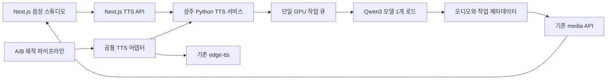

# Qwen3 TTS 음성 스튜디오

작성일: 2026-09-15 · 상태: **웹·로컬 합성·프리셋·A/B 회차 연동 구현**

기존 숏폼 콘솔에 `/voices`를 추가했다. **대본 입력 → 목소리·읽는 방식 설정 → 샘플 생성·듣기 → 후보 비교 → 프리셋 저장 → 회차 적용**을 한 화면에서 수행한다. 실제 Qwen 모델 설치와 GPU 합성까지 연결했다. 이전 독립 HTML 시안은 설계 참고용이며 실제 동작은 Next.js `/voices`에서 제공한다. 실행 방법과 현재 구현 제약은 [실행 안내](../../pipeline/tts-service/README.md), 실측은 [검증 기록](../../pipeline/tts-service/VALIDATION.md)을 기준으로 한다. 아래 본문은 최초 설계 기록이다.

## 1. 현재 구조와 설계 기준

| 확인한 현재 코드 | 설계에 반영할 사항 |
|---|---|
| `pipeline/config/voice.yaml`에 edge-tts 목소리·rate·volume·pitch·발음 사전 저장 | 기존 설정을 읽는 호환 경로를 유지하고 Qwen 설정은 별도 스키마로 추가 |
| `pipeline/web/app/settings/page.tsx`는 환경 점검만 제공 | 작업용 `/voices`와 환경 점검을 구분하고 상호 링크 제공 |
| `shortform/steps/assets.py::_speak`가 edge-tts에 직접 의존 | 공통 합성 인터페이스를 만들고 Edge/Qwen 어댑터로 분리 |
| B안 `assets.py`는 합성 음성 길이로 클립·자막 타임라인 생성 | 음성 설정 변경 시 소재·타임라인·렌더를 오래된 결과로 표시 |
| A안 `video_a.py::_build_audio`도 `_speak`를 호출하고 대사 시작 시각은 기획안 기준 | 공통 어댑터 사용, 대사가 배정 구간을 넘는 경우 별도 처리 |
| B안 피드 카드는 `narration: original` | 회차 적용 대상에서 제외. 스튜디오에서 듣기는 가능 |
| `web/lib/runner.ts`, `/api/jobs/*`에 프로세스 실행·SSE 로그 존재 | 화면 로그 구성은 재사용하되 GPU 큐와 취소는 TTS 서비스에서 관리 |
| `/api/media`가 WAV·MP3와 Range 요청을 지원 | 생성 오디오 재생·탐색에 재사용 |
| C안은 `02-C안-지식역사-모션숏폼.md`의 설계 단계 | C안 실사용 연동은 해당 파이프라인 구현 후 추가 |

이 PC는 **RTX 4060 Ti, VRAM 8188 MiB**다. CustomVoice 0.6B·1.7B와 VoiceDesign 1.7B의 실제 한국어 합성을 확인했다. 생성 시간에는 다운로드·모델 교체가 포함될 수 있어 정상 운영 지연 시간과 구분한다. 발음·음색의 주관적 품질 평가는 사용자의 청취가 필요하다.

**시작 구성 제안:** 로컬 Qwen3 0.6B CustomVoice, 한국어, Sohee를 새 프리셋 초안으로 제시한다. 실제 전역 기본값은 사용자가 변경하기 전까지 기존 Edge 설정이다. 1.7B는 선택 가능하되 모델 로딩 테스트 결과에 따라 사용 가능 여부를 표시한다. 자동으로 모델이나 공급자를 바꾸지 않는다.

## 2. Qwen3 지원 기능과 화면 선택

아래는 공식 공개 모델·Python API 기준이다. 제품의 API와 화면 명칭은 이 문서에서 제안한다.

| 화면 모드 | 공개 모델 | 주요 입력 | 표현 지시 |
|---|---|---|---|
| 기본 목소리 · 기본 모델 | `Qwen/Qwen3-TTS-12Hz-0.6B-CustomVoice` | text, language, speaker | 미지원. 입력 숨김 |
| 기본 목소리 · 표현 조절 모델 | `Qwen/Qwen3-TTS-12Hz-1.7B-CustomVoice` | text, language, speaker, instruct | 지원 |
| 설명으로 만들기 | `Qwen/Qwen3-TTS-12Hz-1.7B-VoiceDesign` | text, language, instruct | 목소리 설명 필수 |
| 참조 음성 사용 | `Qwen/Qwen3-TTS-12Hz-0.6B-Base` 또는 `1.7B-Base` | text, language, ref_audio, ref_text | CustomVoice식 instruct 미지원 |

한국어를 지원하며 Sohee는 한국어를 모국어로 설정한 화자다. 다른 기본 화자도 한국어 생성은 가능하나 발음 품질을 동일하게 보장하지 않는다. 화자·언어 목록은 설치한 모델의 `get_supported_speakers()` / `get_supported_languages()` 결과를 사용한다. 모델 설명과 선택은 [Qwen 공식 저장소](https://github.com/QwenLM/Qwen3-TTS#released-models-description-and-download)를 기준으로 한다.

VoiceDesign 결과를 반복 제작에 쓸 때는 **선택한 결과 WAV와 실제 합성 텍스트를 참조 음성으로 보관한 뒤 Base 모델에서 재사용**한다. 설명만 저장하고 문장마다 새 목소리를 설계하지 않는다. 완전히 같은 음색을 보장한다는 표현도 사용하지 않는다. 공식 [Voice Design then Clone 예시](https://github.com/QwenLM/Qwen3-TTS#voice-design-then-clone)를 따른다.

공식 Python 래퍼는 파형과 샘플레이트를 반환한다. 문장·단어 경계, 네이티브 `speed`·`pitch`·`volume` 필드를 이 API의 지원 기능으로 가정하지 않는다. 참조 대본 생략은 `x_vector_only_mode=True`일 때 가능하지만 초기 제품에서는 대본 입력을 기본으로 둔다. 근거: [Qwen 공식 추론 코드](https://github.com/QwenLM/Qwen3-TTS/blob/main/qwen_tts/inference/qwen3_tts_model.py).

## 3. 화면 설계

### 3.1 진입과 레이아웃

- 사이드바 `파이프라인` 그룹에 **음성 스튜디오** 추가: `/voices`.
- A/B 회차의 기획 영역에 **내레이션 설정** 카드 추가. `음성 스튜디오에서 듣기`는 `/voices?track=B&date=2026-09-15&num=01` 형태로 회차 식별자를 전달한다. 서버에서 회차 존재 여부와 트랙을 검증한다.
- 기본 화면은 **왼쪽: 대본·음성 설정 / 오른쪽: 후보 듣기·저장·적용**. 작은 화면에서는 같은 순서로 세로 배치한다.
- 기존 어두운 배경과 노란 주요 버튼을 이어 쓴다. 사용자가 자주 다루지 않는 모델·기기 정보는 `연결·모델` 접기 영역으로 모은다.

```text
음성 스튜디오                         로컬 엔진 상태 · 연결·모델
기본 목소리 | 설명으로 만들기 | 참조 음성 사용
┌──────────────────────────────┬─────────────────────────┐
│ 대본                         │ 미리듣기 후보            │
│ 직접 입력 / 회차 대본 가져오기 │ 생성 완료 후 재생·탐색    │
│ 표시 원문 / 실제 읽을 문장     │ 후보별 설정·실제 길이    │
│                              │ A / B / C 비교           │
│ 목소리 · 언어                │                         │
│ 읽는 방식 또는 목소리 설명     │ 프리셋 이름             │
│ 생성 음성 속도 · 문장 간격     │ [프리셋 저장]            │
│ 발음 사전 · 고급 설정         │ 적용할 회차·현재 상태    │
│ [샘플 만들기]                │ [이 회차에 적용]         │
└──────────────────────────────┴─────────────────────────┘
```

### 3.2 컨트롤의 의미

아래 범위·제한은 **제품 초기 정책 제안값**이며 Qwen의 공식 한계나 성능 보장값이 아니다.

| 항목 | 초기값·범위 | 동작 |
|---|---|---|
| 미리듣기 대본 | 최대 500자, 빈 문자열 불가 | 회차 전체 생성과 분리. 문자수는 유니코드 코드포인트 기준 |
| 한국어 샘플 | “AI가 알려주는 오늘의 이야기. 가장 가까운 이웃까지 일주일이 걸리는 섬이 있습니다.” | 발음 사전 적용 전후를 함께 확인 |
| 언어 | Korean | 설치 모델의 지원 목록만 선택 가능 |
| 화자 | Sohee 초안 | 기본 목소리 모드에서만 표시 |
| 읽는 방식 | 담백하게 / 활기차게 / 차분하게 / 직접 입력 | 1.7B CustomVoice의 instruct 템플릿. 숫자 ‘감정 강도’는 제공하지 않음 |
| 목소리 설명 | 직접 입력 | VoiceDesign 전용. 예: “따뜻한 중저음의 성인 남성. 또렷하게 한국어를 읽는 다큐멘터리 해설자.” |
| 생성 음성 속도 | 1.00×, 0.80–1.20×, 0.05 단위 | 저장되는 음성을 FFmpeg atempo로 처리. 원본 파형은 보관 |
| 문장 사이 간격 | 180ms, 0–800ms | 여러 문장 조립에만 적용. A안의 고정 대사 시작 시각에는 자동 삽입하지 않음 |
| 발음 사전 | 기존 AI→에이아이 등 상속 | 기존 `speech_text`의 긴 키 우선·문자 그대로 치환 규칙 재사용. 표시 자막은 원문 유지 |
| 재생 속도 | 플레이어의 별도 청취 기능 | 청취에만 영향. 생성 설정·프리셋에는 저장하지 않음 |
| 고급 생성 설정 | 모델 기본값 사용 | seed·temperature 등은 지원 확인된 필드만 허용. 변동성 설정이며 음질 점수로 표시하지 않음 |

0.6B로 바꿀 때 `읽는 방식은 1.7B에서 사용할 수 있습니다`를 표시한다. 1.7B용 초안은 모드별로 보관하되 0.6B 요청에는 instruct를 보내지 않는다. 피치·볼륨은 초기 Qwen 화면에서 제외하고 Edge 전용 기존 설정은 보존한다.

### 3.3 듣기·비교·저장

1. `샘플 만들기`를 누르면 그 순간의 텍스트·설정 사본으로 작업을 만든다. 생성 중 폼을 수정해도 실행 중 요청은 바뀌지 않는다.
2. `대기 → 모델 준비 → 음성 생성 → 후처리 → 완료`로 표시한다. 실제 완료된 단계만 표시하고 임의 퍼센트나 미측정 예상 시간을 보여주지 않는다.
3. 완료 후 실제 오디오가 있을 때 재생·길이·다운로드가 활성화된다. 자동 재생은 하지 않는다. 파형을 표시한다면 실제 PCM에서 계산한다.
4. 비교 후보는 최대 3개를 고정할 수 있다. 카드마다 화자·모델·지시·속도·텍스트 변경 여부를 표시한다. 한 후보를 재생하면 나머지는 멈춘다.
5. 폼이 바뀌면 기존 후보에 `이전 설정으로 만든 샘플` 표시. 저장은 선택한 후보의 설정 스냅샷 또는 현재 초안 중 무엇을 저장하는지 명시한다. 초안도 저장 가능하되 `아직 들어보지 않음`으로 표시한다.
6. `프리셋 저장`, `새 회차 기본값으로 설정`, `이 회차에 적용`은 각자 별도 동작이다. 저장만으로 전역 기본값이나 기존 회차는 바뀌지 않는다.
7. 회차에 적용하면 `새 음성으로 다시 만들기`를 다음 작업으로 제시한다. 기존 오디오·영상은 새 작업이 성공하기 전까지 보존한다.

### 3.4 참조 음성·설명으로 만드는 목소리

- 참조 음성: WAV/MP3/M4A 업로드와 해당 녹음의 대본을 제공한다. 초기 정책은 파일 20MB 이하, 디코딩한 길이 3–30초. 단일 화자·배경음이 적은 5–15초를 안내용 목표로 삼는다. 이 범위는 제품 정책이다.
- 업로드 직후 실제 파일 형식·길이·무음 여부를 검사하고 원본을 들을 수 있게 한다. 파일 확장자만 신뢰하지 않는다. 원격 URL 입력과 직렬화된 모델 프롬프트 파일 업로드는 제공하지 않는다.
- 설명 모드: 후보 생성 → 마음에 드는 후보 선택 → `이 목소리로 저장`. 참조 WAV와 실제 합성 문장이 보관되어야 저장 완료다. 이후 합성 설정은 Base 모드로 고정하고 원래 설명은 출처 메타데이터로 보관한다.
- 참조 음성 프리셋에서는 CustomVoice의 감정 지시를 제공하지 않는다. 기존 화자 목록과 참조 파일 선택도 동시에 보내지 않는다.
- 마이크 녹음은 후속 기능이다. 초기에는 파일 업로드를 제공한다.

### 3.5 주요 상태

| 상태 | 화면과 복구 |
|---|---|
| 연결 안 됨 | 폼·기존 샘플은 유지. 생성 비활성화, 환경 점검으로 연결 |
| 모델 미설치 | 다운로드 필요 상태 표시. 준비 버튼으로 설치 작업과 로그 확인 |
| 작업 중 | 취소 가능, 중복 클릭은 같은 작업 반환 |
| 메모리 부족 | 입력 보존, 0.6B 선택 또는 다른 GPU 작업 종료 후 재시도 안내 |
| 입력/참조 파일 오류 | 해당 필드에 원인 표시, 새 작업 생성하지 않음 |
| 연결 단절·재시작 | 작업 ID로 상태 재조회. 자동으로 같은 음성을 다시 생성하지 않음 |
| 브라우저 재생 차단 | 재생 버튼 유지. 합성 성공과 재생 실패를 구분 |
| 원음 템플릿 회차 | “이 회차는 클립 원음을 사용합니다.” 표시, 회차 적용 비활성화 |
| 후보 생성 후 폼 변경 | 오래된 샘플임을 표시, 선택한 샘플의 설정을 다시 불러오기 가능 |
| 고정된 A안 대사 구간 초과 | 초과 길이 표시, 대본·속도·대사 시각 수정 후 재생성. 묵시적으로 잘라내지 않음 |

## 4. 실행 구조



- Qwen 추론은 **별도 가상환경의 상주 서비스**로 실행한다. 기존 Python 의존성과 PyTorch/Transformers의 충돌을 줄인다. 초기 후보는 공식 권장 Python 3.12 환경이며 실제 패키지 버전은 장비 설치 검증 후 고정한다.
- 로컬 주소는 제안값 `http://127.0.0.1:8765`. FastAPI 기반 HTTP 계약을 **이 프로젝트에서 구현**한다. Qwen Python 패키지가 이 REST API를 이미 제공한다고 가정하지 않는다.
- 모델 다운로드·시작·준비 확인은 설치 단계에서 별도로 처리한다. HTTP 요청마다 모델을 로딩하거나 Next.js 요청 안에서 무거운 추론을 기다리지 않는다.
- GPU는 기본적으로 한 모델만 로드하고 합성도 1개씩 처리한다. 웹과 CLI가 **같은 서비스 큐**를 통과해 서로 메모리를 경쟁하지 않게 한다. 모델 변경은 실행 중 작업이 끝난 뒤 수행한다.
- Windows의 FlashAttention 설치 성공을 전제하지 않는다. 사용 가능한 attention 구현을 실제 로딩으로 확인해 연결·모델 정보에 기록한다. 1.7B가 이 GPU에서 반드시 실행된다는 보장은 두지 않는다.
- TTS 서비스가 작업·취소·상태의 소유자다. 기존 프로세스 러너를 사용할 때는 가벼운 CLI가 작업을 제출하고 상태를 출력하도록 한다. CLI 창/로그를 닫는 것과 추론 서비스 종료를 혼동하지 않는다.
- CPU 실행이나 원격 GPU는 연결 어댑터 확장점으로 둔다. 초기 구현의 기본 실행 경로는 로컬 GPU 하나다.

## 5. 저장 구조와 설정 계약

기존 파일 기반 저장 원칙을 따른다. 아래 경로는 **후속 구현 시 추가할 경로**다.

```text
pipeline/config/voice.yaml                 기존 Edge 호환 설정 유지
pipeline/config/tts.yaml                   스키마 버전·기본 프리셋 ID/리비전
pipeline/data/voices/presets/{id}/{rev}.json 불변 프리셋 리비전
pipeline/data/voices/references/{id}/       참조 WAV·대본·메타데이터
pipeline/data/tts/jobs/{jobId}.json         요청·상태·결과·오류
pipeline/data/tts/cache/{audioKey}/         원본 WAV·후처리 음성·manifest
{회차}/03-소재/voice-settings.json          회차가 선택한 설정 스냅샷
{회차}/03-소재/tts-manifest.json            실제 생성 설정·오디오·타이밍 기록
```

`tts.yaml`이 없거나 기본 프리셋이 지정되지 않았으면 기존 Edge 설정을 사용한다. 기존 `voice.yaml`을 임의로 덮어쓰지 않는다. 기본값 변경은 다음 새 회차부터 사용하고, 기존 회차는 설정이 없을 경우 첫 재생성 때 현재 설정을 스냅샷으로 확정한다. 이미 존재하는 오디오를 설정 파일 부재만으로 재생성하지 않는다.

대표 프리셋 예시(JSON은 제안 계약이며 현재 런타임 코드가 읽지 않는다):

```json
{
  "schemaVersion": 1,
  "id": "korean-briefing",
  "revision": 1,
  "name": "한국어 브리핑",
  "provider": "qwen3-local",
  "mode": "custom_voice",
  "modelId": "Qwen/Qwen3-TTS-12Hz-0.6B-CustomVoice",
  "language": "Korean",
  "speaker": "Sohee",
  "postprocess": {"speed": 1.0, "sentenceGapMs": 180},
  "pronunciations": {"AI": "에이아이", "MBC": "엠비씨"},
  "generation": {"seed": null},
  "testedSampleId": null
}
```

- `custom_voice`: speaker 필수. instruct는 1.7B에서만 허용한다.
- `voice_design`: instruct 필수, speaker·referenceId 금지. 재사용 프리셋으로 확정할 때 `voice_clone`으로 전환한다.
- `voice_clone`: referenceId, 참조 콘텐츠 해시, 대본 필수. speaker·instruct 금지. `provenance`에 VoiceDesign 원본 설명을 별도로 기록할 수 있다.
- 공급자별 discriminated union으로 검증해 Edge의 `rate: "+3%"` 등이 Qwen 요청으로 새지 않게 한다.
- 회차는 프리셋 ID만 참조하지 않고 **리비전과 전체 설정 사본**을 보관한다. 프리셋 수정으로 지난 회차의 목소리가 바뀌지 않는다.
- 저장은 임시 파일 작성 후 원자적 교체. 동시 편집은 expectedRevision 또는 If-Match로 충돌을 알려 덮어쓰기를 방지한다.
- 원격 연결 토큰·서비스 주소는 서버 환경설정에 저장하고 프리셋 응답에 포함하지 않는다.

### 캐시와 파일 보존

**원본 합성 키**는 실제 읽을 문장, provider, 모델·토크나이저 revision, mode, speaker, instruct, language, 참조 음성·대본 해시, 실제 적용된 generation 설정과 seed로 계산한다. 발음 치환 후 문장은 키에 포함하고 발음 사전 리비전·합성 전 원문은 manifest에도 남긴다. **후처리 키**에는 원본 키와 속도·출력 포맷·후처리 버전을 추가한다. 문장 간격은 합성 키가 아닌 여러 문장의 조립 키에 포함한다.

같은 조건의 `샘플 만들기`는 완료 캐시를 재사용할 수 있고 `다른 테이크 만들기`는 새 seed/nonce를 부여한다. 샘플과 본편은 같은 전처리·후처리 경로를 사용한다. 동일한 문장·설정·선택한 테이크라면 이미 들은 오디오 파일을 재사용한다. seed만으로 환경을 넘어 비트 단위 동일성을 보장하지 않는다.

임시 미리듣기 파일은 초기 정책상 7일 후 정리 가능하다. 프리셋 참조 음성, 고정 후보, 회차가 사용하는 파일, 실행 중 작업 파일은 보존한다. 참조 삭제 시 사용 중인 프리셋을 알려 주고, 회차 결과 파일은 캐시 정리와 별도로 관리한다. 캐시와 참조 오디오는 git 추적에서 제외한다.

## 6. API 계약

아래 `/api/tts/*`는 새 Next.js 엔드포인트 제안이다. 서비스 URL·파일 경로·임의 shell 인자를 브라우저에서 받아 실행하지 않는다.

| 메서드·경로 | 책임 |
|---|---|
| `GET /api/tts/capabilities` | 연결 상태, 설치/준비된 모델, 화자·언어, instruct/clone 지원 여부 |
| `GET /api/tts/presets` | 프리셋 목록과 최신 리비전 |
| `POST /api/tts/presets` | 새 프리셋 또는 새 불변 리비전 저장 |
| `PUT /api/tts/default` | 새 회차용 기본 프리셋 ID·리비전 저장 |
| `POST /api/tts/references` | 제한된 multipart 업로드, 디코딩 검사, 참조 ID 반환 |
| `POST /api/tts/previews` | 검증된 초안으로 비동기 합성 제출, HTTP 202와 jobId 반환 |
| `GET /api/tts/jobs/{id}` | queued/loading/generating/postprocessing/done/failed/cancelled/interrupted와 실제 결과 |
| `POST /api/tts/jobs/{id}/cancel` | GPU 서비스에 취소 요청 전달 |
| `PUT /api/tts/episode` | 회차 식별자·프리셋 리비전으로 설정 사본 저장, 영향 받는 결과 반환 |
| `POST /api/tts/episode/generate` | 고정된 회차 대본·설정으로 전체 또는 선택 문장 재생성 |

예: 미리듣기 요청은 `{text, config, take: "reuse", idempotencyKey}`이며 config는 위 공급자별 스키마로 검증한다. 완료 응답은 `{jobId, sampleId, audioUrl, durationMs, resolvedConfig, configHash, cacheHit, timings}`를 포함한다. `durationMs`는 후처리된 파일을 측정한 값이고, `timings`는 수집된 단계 시간만 제공한다.

초기에는 1초 간격 폴링으로 시작하고 백그라운드 탭에서는 5초로 늦춘다. 이 수치는 제품 정책이다. 전체 제작 작업의 로그는 기존 SSE 구성을 재사용할 수 있다. 화면을 닫아도 제출된 작업은 계속되고 다시 열 때 jobId로 조회한다.

검증 실패 400, 파일 초과 413, 입력 조합/참조 음성 부적합 422, 리비전 충돌 409, 큐 용량 초과 429, 엔진 연결 불가 503을 구분한다. 런타임 모델 메모리 오류 등은 조회 HTTP 200의 작업 `failed` 상태와 구조화된 `error.code`로 반환한다. 제품 초기 제한은 미리듣기 500자, 전체 생성 요청 10,000자·200문장, 대기 작업 20개로 두고 측정 후 조정한다.

### 큐·취소·재시작

- 동일 idempotencyKey와 동일 요청이면 같은 jobId 반환, 다른 본문이면 409. 중복 클릭으로 GPU 작업을 늘리지 않는다.
- 대기 중 취소는 즉시 제거한다. 실행 중에는 취소 요청 상태를 먼저 표시하고 안전한 중단 시점을 기다린다. 라이브러리가 즉시 취소를 지원한다고 가정하지 않는다.
- 중단 시점을 확보할 수 없으면 해당 추론을 끝까지 기다리되 결과를 확정하지 않는다. 강제 중단이 필요하면 서비스 감독자가 추론 자식 프로세스만 재시작하고 다음 작업 전에 모델을 준비한다.
- 서비스 재시작 시 실행 중이던 작업은 interrupted. 대기 요청은 만료·중복 여부를 점검한 후 복구한다. 브라우저 재접속은 새 작업을 만들지 않는다.
- 전체 회차 생성은 문장별 체크포인트를 남긴다. 취소·실패 시 완료 캐시는 보존하되 기존 완성본 포인터와 manifest는 성공 전까지 교체하지 않는다.

## 7. 기존 영상 파이프라인과 통합

### 공통 합성 결과

`shortform/tts/` 아래 config 로더, Edge 어댑터, Qwen 서비스 클라이언트, 후처리·manifest 모듈을 둔다. 호출 결과는 audioPath, sampleRate, duration, speechStart, speechEnd, timingSource, resolvedConfigHash를 가진다. 단위는 초로 통일한다.

- Edge는 기존 SentenceBoundary를 사용한다.
- Qwen은 반환된 파형을 후처리한 뒤 길이를 측정하고, 필요 시 VAD로 발화 구간을 추정한다. VAD가 없으면 문장 전체 오디오 구간을 사용하고 `timingSource: "estimated"`로 기록한다.
- 단어 경계가 필요한 현재 `_distribute`는 추정 모드로 유지한다. Qwen이 정확한 한국어 단어 타임스탬프를 준다고 표시하지 않는다. 강제 정렬은 한국어 지원·속도·품질 검증 후 후속 옵션으로 추가한다.
- 속도 변경 후 파일 기준으로 길이와 경계를 다시 계산한다. 원본 파형 타이밍을 그대로 사용하지 않는다.
- 문장 오디오를 공통 PCM 형식으로 변환해 간격을 넣고 합친 뒤 MP3를 한 번 인코딩한다. 기존 렌더가 기대하는 `narration.mp3`를 계속 제공하며 개별 오디오를 불필요하게 반복 압축하지 않는다.

### 트랙별 적용

| 트랙 | 적용과 오래된 결과 처리 |
|---|---|
| B · 브리핑 포커스 | 새 오디오 길이로 자막·클립 길이·타임라인 재계산. assets/render를 오래됨으로 표시 |
| B · 원음 피드 카드 | TTS 생성·적용 안 함. 기존 원음 동작 유지 |
| A · 대사 영상 | `video_a.py`의 대사 합성 교체. 시작 시각 유지, 허용 구간은 다음 대사 시작/컷 종료/본편 종료 중 적용 가능한 상한으로 정의. 초과 시 수정 필요 상태 |
| C · 지식 모션 | 공통 결과 인터페이스를 사용할 수 있도록 설계만 확보. 현재 실행 가능하다고 표시하지 않음 |

B안에서 한 문장만 다시 합성해도 이후 문장의 시작 시각과 전체 자막·클립 구간은 다시 계산한다. 다른 문장의 동일 오디오는 캐시를 재사용한다. A안은 음성이 달라졌다는 이유만으로 유료 영상 생성 작업을 다시 호출하지 않도록 **대사 합성·믹싱·최종 결합을 기존 video 단계에서 분리**해야 한다.

설정·텍스트 해시가 바뀌면 assets/video/render 완료 플래그만 믿지 않는다. 산출 manifest와 현재 입력을 비교해 `기존 완성본 / 새 설정 반영 필요`를 표시한다. 신규 결과가 완성될 때 파일과 manifest를 함께 교체한다. 업로드를 자동 시작하거나 완료로 기록하지 않는다.

### 로컬 연결 경계

서비스는 loopback에 바인딩하고 브라우저는 같은 출처의 Next API만 사용한다. 쓰기 API는 Origin 검사, 검증된 설정 스키마, 제한된 파일 저장 루트를 적용한다. 업로드 파일은 서비스가 발급한 ID로만 참조하며 사용자 입력 경로를 열지 않는다. 로그에는 토큰·참조 원본 전체를 남기지 않는다. 외부 공개 배포를 할 경우에는 별도 인증 설계를 먼저 추가해야 한다.

## 8. 구현 순서와 변경 파일

| 단계 | 구현 범위 | 완료 판단 |
|---|---|---|
| 1 · 기본 합성 | 별도 Qwen 환경, 0.6B 모델, 상주 서비스·큐, Edge 호환 config, 실제 한국어 WAV | 같은 서비스로 웹과 CLI 요청 성공. 실제 생성 시간·최대 VRAM 기록 |
| 2 · 듣고 저장 | `/voices`, 후보 재생·비교, 발음/속도, 캐시, 프리셋 | 브라우저에서 생성 오디오 재생·탐색·저장 후 재열기 가능 |
| 3 · 회차 통합 | B안 타임라인, A안 대사 재합성 분리, 원음 템플릿 제외, 오래된 결과 표시 | 프리셋을 적용한 본편에서 동일 설정이 실제로 들림 |
| 4 · 목소리 확장 | 1.7B CustomVoice, VoiceDesign→Base 저장, 참조 업로드 | 장비에서 성공한 기능만 활성화하고 동일 참조로 여러 문장 생성 확인 |

예상 변경 위치:

- 추가: `pipeline/web/app/voices/page.tsx`, `components/voices/VoiceStudio.tsx`, `VoiceSettings.tsx`, `SampleCompare.tsx`, `EpisodeVoiceSettings.tsx`.
- 추가: `pipeline/web/app/api/tts/*`, `pipeline/web/lib/ttsTypes.ts`, `tts.ts`.
- 추가: `pipeline/shortform/tts/*`, `pipeline/tts-service/`의 독립 환경·서비스·실행 안내.
- 수정: `Nav.tsx`, `EpisodeView.tsx`, `Doctor.tsx`, `/api/doctor`, `inspect.py`, `types.ts`, `cli.py`.
- 수정: `steps/assets.py`, `steps/video_a.py`, 완료 상태·manifest 판정 부분. 기존 `test_tts_text.py` 발음 치환 회귀 유지.
- Next.js 코드 구현 전 `pipeline/web/AGENTS.md`가 지정한 설치 버전의 로컬 Next 문서를 읽는다.

## 9. 구현 수용 기준

1. 한국어 대본으로 **실제 Qwen 음성** 생성·재생·탐색·다운로드가 된다. 무음·가짜 음원·브라우저 기본 TTS로 성공을 대신하지 않는다.
2. 0.6B/Clone에서는 instruct가 노출되거나 전달되지 않는다. 모델·모드별 잘못된 입력 조합은 서버에서도 거부한다.
3. 생성 중 초안 수정, 중복 클릭, 탭 재접속, 작업 취소에서 요청 사본·작업 ID·화면 상태가 일치한다.
4. 기존 후보와 다른 설정을 저장/적용할 때 사용자가 어느 설정인지 구분할 수 있다. 한 번에 한 오디오만 재생된다.
5. 프리셋 저장·전역 기본값 변경·회차 적용이 분리되고 회차 리비전은 고정된다. 저장 후 새로고침해도 유지된다.
6. 발음·속도·참조 파일·모델 리비전 변경은 캐시 키에 반영된다. 같은 테이크 선택 시 샘플과 본편이 동일 오디오를 사용한다.
7. B안 원음 템플릿은 TTS를 호출하지 않는다. B안 TTS 길이 변경은 자막·클립 타임라인에 반영된다.
8. A안 대사 구간 초과를 검출하고 기존 컷 영상의 유료 재생성 없이 음성만 다시 만들 수 있다.
9. 연결 실패·GPU 메모리 부족·재시작·도중 실패에서 기존 완성본과 입력이 보존된다. 캐시 정리가 참조·회차 음성을 삭제하지 않는다.
10. 320px 폭에서 입력/버튼이 잘리지 않고, 키보드로 선택·생성·재생 가능하며 상태 변화가 접근성 알림으로 전달된다.

코드 구현 시 설정·캐시·큐·회차 연결에 의미 있는 자동 검증을 추가한다. 실제 GPU 합성과 한국어 청취 품질은 별도의 장비 검증으로 남긴다. **이번 설계 작업에서 실제 합성, API 동작, 오디오 품질은 검증하지 않았다.**

## 10. 근거와 남은 검증

- [Qwen3-TTS 공식 저장소](https://github.com/QwenLM/Qwen3-TTS): 모델 분류, 한국어, 화자, 설치 환경, VoiceDesign→Clone 흐름.
- [Qwen3TTSModel 공식 코드](https://github.com/QwenLM/Qwen3-TTS/blob/main/qwen_tts/inference/qwen3_tts_model.py): 실제 입력·반환값, 지원 목록, 생성 인자.
- [Qwen 공식 웹 데모](https://huggingface.co/spaces/Qwen/Qwen3-TTS): 외부에서 기능을 체험할 수 있는 별도 데모. 우리 콘솔의 저장·회차 적용과 연동되지는 않는다.
- 내부 근거: 1절에 명시한 현행 파일과 2026-09-15 GPU 조회. 기존 작업 중인 코드의 수정사항도 읽기 기준에 포함했다.

후속 첫 구현에서 확인할 항목은 Windows 추론 환경, 실제 0.6B/1.7B 최대 메모리, 한국어 이름·숫자 발음, 짧은 문장 연결 품질, A안 대사 시간 적합성이다. 1.7B 사용 가능 여부와 생성 시간은 이 측정 후 확정한다.
