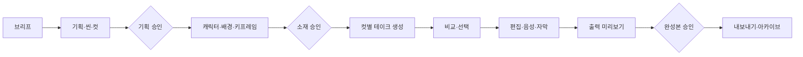

# Take Studio — 캔버스와 테이크 중심 제작 환경

2026-09-23 · 설계 초안 v1 · 대상: `shortform-automation`

**결정 제안:** 현재 제작 콘솔을 프로젝트 단위의 스튜디오로 발전시킨다. 중앙에는 레퍼런스와 생성 결과의 관계를 보여 주는 노드 캔버스, 상단에는 제작 단계, 우측에는 선택한 컷의 연출·생성 설정, 하단에는 테이크 비교와 편집 순서를 둔다. 기존 생성·렌더 엔진을 재사용하면서 컷별 버전 관리와 실행 단위를 추가한다.

이번 산출물은 설계와 시안이다. 실제 생성·과금·내보내기·운영 배포를 구현하거나 실행하지 않았다. [클릭 가능한 화면 시안](../mockups/take-studio.html)은 브라우저 메모리 안의 예시 데이터만 사용한다.

## 1. 참고 화면에서 확인한 것

직접 확인한 출처:

- **R1 [Newtake 홈](https://www.newtake.ai/ko)**: 접힌 아이콘 사이드바, 새 프로젝트, 프로젝트·자산·갤러리·디렉터 스튜디오, 추천 프리셋, 모델별 제작 진입, 제작 과정 보기. 홈의 모델명·모델 성능 문구는 서비스 표시이며 우리 시스템의 지원 확약이 아니다.
- **R2 [PARKOUR SPEED INLINE 제작 캔버스](https://www.newtake.ai/ko/detail/41eab47cea4f423ab39b4b9711eb63a5)**: 읽기 전용 제작 과정, 프로젝트 복사, 이미지·영상 노드, 그룹, 이미지 크기, 참조 연결선, 노드 선택, 미니맵·연결선 표시·줌 컨트롤. 캐릭터/소품/배경 참조들이 여러 영상 노드로 연결되어 있었다.
- **R3 [디렉터 스튜디오](https://www.newtake.ai/ko/director-studio)**: 레퍼런스 0/50 표시, `@` 소재 참조 안내, 내러티브·비주얼 스타일·촬영, 이미지/비디오 선택, 텍스트→비디오 모드, 해상도·길이·생성 개수·예상 크레딧, 프리셋 스택 적용. 촬영 패널의 카메라·렌즈·초점거리·조리개와 카메라 무빙 프리셋을 열어 확인했다.

**관찰 범위:** 레이어 편집·구간 리메이크·멀티 앵글·조명 보정·스마트 영상 분석·Autolink·긴 영상·플러그인은 홈의 기능 소개/진입점을 확인했다. 해당 기능의 생성 품질, 내부 구현, 전체 편집 플로우는 검증하지 않았다. 읽기 전용 캔버스를 복사하거나 유료 생성을 실행하지 않았다. 테이크 비교·타임라인·자동 저장·실행 복구는 아래에서 제안하는 우리 제품 기능이며 Newtake에서 모두 직접 검증한 기능이라는 뜻이 아니다.

## 2. 제품 범위와 용어

### 제작 공간과 운영 공간

- **제작 스튜디오:** 기존 `pipeline/web` Next.js 앱. Python·ffmpeg·Remotion·로컬 모델을 실행한다. 1차는 개인 로컬 제작 환경이다.
- **원격 아카이브:** 기존 `viewer` Cloudflare Pages + R2. 완성본과 선정한 제작 과정을 읽기 전용으로 본다.
- **원격 제작:** 후속 단계. 별도 인증 API·작업 큐·로컬/서버 워커·객체 저장소가 필요하다. 정적 Pages 화면에 로컬 제작 API만 붙이면 원격 제작이 되는 것으로 설계하지 않는다.

| 개념 | 정의 | 예 |
|---|---|---|
| 프로젝트 | 하나의 제작 목적과 산출물 묶음 | 세럼 15초 광고 |
| 씬 | 장소·목적·연출을 공유하는 컷 묶음 | 제품 소개 / 사용 장면 |
| 컷(Shot) | 타임라인에 들어가는 하나의 연속 구간 | 03. 제품을 향한 달리 인 |
| 테이크(Take) | 한 컷/노드의 특정 입력으로 만든 변경 불가 생성 시도 | 컷 03의 take 1, 2, 3 |
| 자산(Asset) | 이미지·영상·음성·문서 원본과 메타데이터 | 캐릭터 시트, 선택한 테이크 영상 |
| 노드(Node) | 자산 또는 작업을 캔버스에서 표현하는 객체 | 이미지 참조, 영상 생성, 내레이션 |
| 연결(Edge) | 역할이 명시된 입력·출력 관계 | 캐릭터 참조 / 시작 프레임 / 오디오 |
| 선택 테이크 | 그 컷에서 현재 편집에 쓰기로 정한 결과 | 컷 03 → take 2 |

**노드 하나 = 실행 한 번**으로 고정하지 않는다. 생성 노드 하나에 여러 테이크가 남고, 자산 노드는 실행하지 않는다. 컷 순서와 캔버스 좌표도 독립이다.

## 3. 기능 대응표

상태: **직접**=화면·컨트롤 관찰, **소개**=홈 소개만 확인, **제안**=우리 제품 추가 설계.
단계: **1차**=기존 엔진과 연결하는 핵심, **2차**=연출/편집 확장, **3차**=외부 모델·원격 연동.

| 기능군 | 근거 | 우리 제품 적용 | 현재 기반 / 추가 필요 | 단계 |
|---|---|---|---|---|
| 프로젝트 홈·최근 작업 | R1 직접 | 썸네일·진행 단계·다음 작업·이어하기 | 회차/외주 목록을 통합 인덱스로 묶기 | 1차 |
| 새 프로젝트·프리셋 | R1 직접 | 목적→형식→브리프→씬/컷 초안 | NewEpisodeForm·episodePlanning 재사용 | 1차 |
| 무한 캔버스 | R2 직접 | 이동·줌·맞춤·검색·미니맵 | 새 캔버스 UI | 1차 |
| 이미지/영상 노드 | R2 직접 | 썸네일, 비율, 길이, 상태, 테이크 수 | CutBoard·media 연동 | 1차 |
| 텍스트·오디오·출력 노드 | 제안 | 기획/프롬프트/TTS/렌더를 같은 흐름에 표시 | PlanEditor·TTS·Remotion 어댑터 | 1차 |
| 참조 연결 | R2 직접 | 역할별 포트, 지원 형식 검증, 영향 범위 표시 | 생성 요청 입력 계약 추가 | 1차 |
| 그룹·씬 정리 | R2 직접 | 씬별 접기·펼치기·자동 정렬 | 그룹 좌표/멤버십 저장 | 1차 |
| 복사·삭제·실행 취소 | 복사는 R2 직접, 나머지는 제안 | 노드/프로젝트 복제, 편집 undo/redo | 실행과 편집 이력 분리 | 1차 |
| 자산 라이브러리 | R1 직접 | 폴더·종류·태그·검색·현재 프로젝트 참조 | 릴스 라이브러리 + 일반 자산 인덱스 | 1차 |
| 다중 레퍼런스·@참조 | R3 직접 | 역할 지정 참조 칩, 실제 asset ID 바인딩 | 현재 시트/키프레임 경로를 ID로 감싸기 | 1차 |
| 캐릭터 디자인 시트 | R1 소개 | 인물별 시트·락 블록·버전 고정 | images_a.py 기반 | 1차 |
| 스토리보드 | 제안 | 컷 순서·길이·대사·참조를 카드로 편집 | PlanA.cuts·릴스 storyboard 활용 | 1차 |
| 이미지 생성·수정 | R3 직접 | 컷 이미지 생성, 수정 지시, 새 테이크 보존 | codex 이미지 어댑터 분리 | 1차 |
| 이미지→영상 | R2 관계 관찰 | 키프레임 기반 컷 영상 | fal 호출을 컷/테이크 단위로 분리 | 1차 |
| 텍스트→영상·영상→영상 | 텍스트 모드는 R3 직접, 후자는 제안 | 지원 모델에서만 노출 | 모델별 어댑터 필요 | 2~3차 |
| 테이크 비교·선택·복원 | 제안 | 나란히 비교, 선택본 고정, 이전 결과 복원 | 불변 테이크 저장소 신규 | 1차 |
| 선택 컷만 재생성 | 구간 재생성은 R1 소개 | 다른 컷 보존, 새 결과는 후보로 추가 | 현재 고정 경로 재실행 방식 수정 | 1차 |
| 음성·자막·음악·효과음 | 제안 | 별도 오디오 노드와 타임라인 트랙 | Qwen/edge-tts·기존 렌더 활용 | 1~2차 |
| 내러티브·장르·리듬 | R3 직접 | 프롬프트 프리셋 + 컷 구성 제안 | 자체 프롬프트 묶음 제작 | 2차 |
| 비주얼 스타일·색감·조명 | R3 직접 | 샘플 카드로 선택, 컷별 override | 스타일 스키마/프롬프트 컴파일러 | 2차 |
| 카메라·렌즈·초점거리·조리개 | R3 직접 | 연출 의도 입력, 기본/고급 설정 | PlanCut.lens/camera 확장 | 2차 |
| 카메라 무빙 | R3 직접 | 고정·팬·틸트·달리·오빗 등 미리보기 | 프롬프트 지시, 실제 물리 제어 아님 | 2차 |
| 멀티 앵글 | R1 소개 | 각 앵글을 새 컷 또는 후보로 생성 | 인물 일관성 평가 및 모델 지원 확인 | 2차 |
| 조명 보정 | R1 소개 | 색보정 필터 / 생성형 재조명 구분 | 후자는 별도 편집 모델 필요 | 2~3차 |
| 구간 리메이크·영상 연장 | R1 소개 | 인·아웃 표시, 새 구간 후보로 합성 | 모델 네이티브 편집 여부에 따라 분리 | 3차 |
| 레이어 편집 | R1 소개 | 텍스트/로고/자막/이미지 레이어부터 | 기존 상세 디자인·Remotion 활용 | 2차 |
| 스마트 영상 분석 | R1 소개 | 원본→장면/대본/연출 분석→컷 생성 | reels 분석·ffmpeg 프레임 활용 | 2차 |
| 자동 참조 연결(Autolink) | R1 소개 | @참조에 따른 명시 연결부터, 추론은 제안만 | 잘못 연결된 자산 검토 UI | 2차 |
| 모델 선택·생성 설정·비용 | R1/R3 직접 | 기능별 지원 모델과 실제 예상 요금 | capability registry·estimate 필요 | 1~3차 |
| 긴 영상 | R1 소개 | 다중 컷 조합을 우선, 단일 장기 생성은 별도 | 기존 렌더 + 연속성 관리 | 2~3차 |
| 생성 큐·취소·실패 재시도 | 제안 | 컷별 상태, 재시작 복구, 중복 과금 방지 | runner 확장·영속 상태 추가 | 1차 |
| 타임라인·출력 | 제안 | 선택 테이크만 편집→검수→출력 | TimelineEditor·PlayerPane·Remotion | 1차 |
| 제작 과정 보기·템플릿 복사 | R1/R2 직접 | 승인한 결과+가공된 그래프 스냅샷 | archive manifest 확장 | 2차 |
| ChatGPT/Blender 연결 | R1 메뉴 직접 | API 계약 먼저, 커넥터/애드온은 후속 | 새로운 인증·작업 요청 경계 | 3차 |
| 요금제·이벤트·공개 커뮤니티 | R1 직접 | 개인 제작 도구에는 필수 아님 | 자체 비용 기록/개인 프리셋으로 대체 | 보류 |

목표는 주요 제작 기능군을 수용하는 것이다. 특정 서비스의 모델 접근권, 크레딧 체계, 생성 품질까지 동일하다고 가정하지 않는다. 로고·고유 그래픽·샘플 영상은 가져오지 않고 자체 UI와 자료를 사용한다.

## 4. 정보 구조와 화면

```text
홈                     최근 작업 / 새 제작 / 프리셋 / 현재 작업 큐
프로젝트                숏폼·릴스·상세페이지·카드뉴스·인스타툰 / 고객·태그·단계 필터
프로젝트/:id/studio      브리프 → 기획 → 소재 → 테이크 → 편집 → 검수·내보내기
자산                    이미지·영상·음성·문서 / 캐릭터·브랜드 킷
디렉터 도구              영상 분석 / 캐릭터 / 앵글 / 조명 / 스타일
아카이브                완성본 / 선정한 제작 과정 / 버전별 출력
운영                    외주·월간 보드·작업 기록·설정
```

블로그는 전용 원고 편집을 유지하고 프로젝트 홈에서 연결한다. 모든 콘텐츠를 영상 타임라인으로 강제하지 않는다. C안은 현재 샘플이며 A/B와 동등한 제작 트랙으로 표시하려면 실행 파이프라인부터 추가해야 한다.

### 홈

큰 배너보다 작업 이어하기를 먼저 보여 준다. 카드에는 대표 이미지, 제목, 형식, 진행 단계, 마지막 수정, 다음 작업을 담는다. 새 제작은 `AI 숏폼 / 기존 영상 재편집 / 제품 상세 / 카드뉴스·인스타툰`의 목적 선택부터 시작한다. 현재 로컬 저장소 자료는 기존 프로젝트로 불러올 수 있다.

### 제작 스튜디오

```text
┌ 프로젝트 / 저장 상태          단계: 브리프—기획—소재—테이크—편집—내보내기 ┐
│ 자산·노드 도구 │ 캔버스 / 스토리보드 / 미리보기 │ 선택한 컷의 속성          │
│ 캐릭터        │ 캐릭터 ─┬─ 컷 01 ─┐           │ 프롬프트·@참조            │
│ 배경·소품     │ 배경 ───┤         ├─ 편집본   │ 스타일·촬영·음성          │
│ 스타일·오디오 │ 제품 ───┴─ 컷 02 ─┘           │ 모델·길이·비율·예상 비용  │
│               │ 확대·맞춤·미니맵               │ 선택 컷 생성              │
├───────────────┴──────────────────────────────┴──────────────────────────┤
│ 컷 목록 / take 1 · take 2 · take 3 비교 / 선택본 → 편집 순서              │
└ 현재 실행 상태 · 다음 작업 이유 · 다음 단계로                            ┘
```

- 사이드바는 스튜디오 진입 시 축소된다. 캔버스에 공간을 준다.
- 단계를 바꿔도 프로젝트·컷 선택·캔버스 위치는 유지한다. URL에 `stage`, `shot`, `view`를 저장한다.
- `캔버스/스토리보드/미리보기`는 같은 데이터의 다른 보기다. 새 프로젝트의 기본은 스토리보드, 참조 연결이 필요한 작업은 캔버스다. 마지막 사용 보기를 기억한다.
- 중앙 노드를 선택하면 우측 속성과 하단 테이크가 함께 바뀐다. 한 컷의 변경이 다른 컷에 적용되지 않는다.
- 진행 버튼은 `다음` 대신 `기획 승인하고 소재 준비`, `선택 테이크로 편집`, `검수 후 내보내기`처럼 동작을 말한다.
- 미완성 단계도 열어 볼 수 있다. 생성·승인·내보내기만 요구조건에 따라 제한하며 그 이유를 함께 표시한다.
- 테이크 비교는 2개 나란히 재생, 동일 시점 보기, 확대, 입력 차이, 선택본 표시를 제공한다. 다른 길이의 영상은 공통 구간만 동기화한다.

### 디렉터 패널

연출 프리셋은 `내러티브 / 시각 스타일 / 촬영 / 음향` 네 범주다. 초보자는 예시 카드, 고급 사용자는 세부값을 연다. 프로젝트 기본값을 컷이 상속하되 개별 컷에서 변경할 수 있다. 프롬프트로 전달되는 설정과 공급자 API가 직접 지원하는 파라미터를 구분한다. 초점거리/조리개를 넣었다는 이유만으로 생성 결과가 물리적으로 정확하다고 표시하지 않는다.

### 시각 규칙

- 차콜 배경 `#111315`, 패널 `#1b1f22`, 경계 `#343b40`, 본문 `#f2f4f5`, 보조 `#aab3ba`.
- 주요 동작은 라임 `#cbf279` + 어두운 글자. 경고는 앰버, 오류는 코럴. Newtake의 보라 포인트와 별도의 정체성을 둔다.
- 8px 간격 체계, 카드 12px·대형 패널 16px 라운드, 본문 14px·제목 20~28px. 수치/타임코드만 monospace.
- 상태는 색+아이콘+텍스트. 버튼에 접근 가능한 이름을 주고 툴팁에만 기능명을 숨기지 않는다.
- 전체 페이지와 입력 폼은 키보드로 이동 가능. 드래그 대안으로 위치/순서 버튼을 제공한다. 확대 200%와 줄어든 모션을 고려한다.
- 데스크톱: 좌측 64px 도구, 보조 자산 220px, 우측 320px 가변 패널. 작은 화면에서는 우측을 드로어로 전환한다.
- 모바일: 컷 카드·검수·테이크 선택 중심. 캔버스 정밀 편집은 데스크톱 권장으로 안내한다.

## 5. 제작 흐름과 승인



1. 브리프에서 목적, 시청자, 길이, 비율, 스타일, 참조를 정한다.
2. 기획에서 씬/컷을 제안하고 대사·액션·카메라·길이를 수정한다. 승인한 revision을 기록한다.
3. 소재에서 시트와 키프레임을 만들거나 가져온다. A안의 시트 일관성·프레임 검사를 사용한다.
4. 각 컷에서 원하는 수의 테이크를 요청한다. **첫 결과를 자동 확정하지 않는다.** 결과가 도착하면 후보가 추가된다.
5. 사용자가 컷별 선택본을 정하고 편집 순서로 보낸다. 선택 변경은 편집 미리보기를 갱신하지만 이미 출력한 파일은 보존한다.
6. 출력 전 누락된 필수 컷, 오래된 입력, 음성/자막, 비율·길이를 확인한다. 외부 게시와 아카이브 반영은 별도 동작으로 둔다.

**B안 변형:** 소재는 기존 영상의 인/아웃 선택이다. 테이크는 자막·크롭·레이아웃·편집안의 변형이 될 수 있으며 AI 영상 생성을 요구하지 않는다.
**상세페이지/카드뉴스 변형:** 컷 대신 섹션/슬라이드에 테이크를 묶는다. 결과 선택과 버전 관리만 공통으로 사용한다.

### 변경 후 상태

- 노드의 위치·색·이름만 바꿀 때는 생성 결과를 오래된 상태로 만들지 않는다.
- 프롬프트/선택 참조/생성 설정 변경 시 해당 노드와 의미상 의존하는 하위 노드에 `입력 변경됨` 표시를 한다. 자동 유료 재생성은 하지 않는다.
- 참조는 **선택된 특정 테이크/자산 버전**에 고정한다. 새로운 후보가 도착해도 다른 컷의 입력은 자동 교체되지 않는다.
- 캐릭터 시트 교체 시 이를 쓰는 컷을 목록으로 보여 주고, 적용 대상과 다시 만들 범위를 선택한다.
- 승인 기록은 `revision + inputFingerprint + selectedTakeIds`에 연결한다. 입력이 달라지면 그 승인만 만료시킨다.
- 실행 중 편집한 새 프롬프트가 기존 실행 요청에 섞이지 않는다. 완료 결과에 당시 입력 버전을 표시한다.

## 6. 데이터와 파일 계약

기존 파일 규약을 즉시 이관하지 않는다. **1차는 기존 프로젝트를 읽기 전용으로 매핑하고, 사용자가 스튜디오 전환을 선택하면 그 프로젝트에만 별도 작업 문서를 만든다.** 기존 CLI와 신규 스튜디오의 동시 쓰기는 막는다.

```text
<기존 프로젝트 폴더>/
  기존 기획안·소재·완성본 ...
  .studio/
    project.json              통합 문서: revision, 씬/컷, 노드, 연결, 선택본, 승인
    layout.json               좌표·뷰포트·접힌 그룹; 렌더 입력에서 제외
    takes/<takeId>/
      request.json            정규화 입력·참조 버전·모델·설정의 불변 스냅샷
      result.json             결과 상태·자산 ID·길이·오류·원격 요청 ID
      output.*                생성 결과, 덮어쓰지 않음
    exports/<exportId>/
      manifest.json           사용 테이크/자산/타임라인 revision
      final.mp4
pipeline/data/studio/
  index.json                  재생성 가능한 프로젝트 검색 인덱스
  assets/index.json           원본 위치·해시·형식·크기·태그·사용처
  runs/<runId>.json           영속 실행 상태·입력 해시·providerRequestId
```

논리 스키마(설계용, 아직 코드에 추가하지 않음):

```ts
type Project = {
  schemaVersion: 1; id: string; revision: number;
  kind: 'shortform'|'reels'|'detail'|'cardnews'|'instatoon';
  legacyRef?: { path: string; track?: 'A'|'B' };
  scenes: Scene[]; shots: Shot[]; nodes: Node[]; edges: Edge[];
  approvals: Approval[];
};
type Shot = {
  id: string; sceneId: string; order: number; targetDurationMs: number;
  generationNodeId: string; selectedTakeId: string | null;
};
type Take = {
  id: string; nodeId: string; parentTakeId?: string; runId: string;
  requestFingerprint: string; inputAssetVersions: string[];
  outputAssetIds: string[]; status: RunStatus;
};
type Edge = {
  id: string; fromNodeId: string; toNodeId: string;
  sourceAssetVersionId?: string;
  role: 'character'|'background'|'style'|'startFrame'|'endFrame'|'audio'|'clip'|'text';
};
type RunStatus = 'queued'|'running'|'succeeded'|'failed'|'cancelRequested'|'cancelled'|'unknown';
```

- 실제 구현 시 스키마 런타임 검증과 schemaVersion migration을 함께 만든다. 화면 타입만으로 입력을 신뢰하지 않는다.
- 입력 fingerprint에는 모델 식별자/버전, 프롬프트, 시드(지원 시), 비율, 길이, 자산 내용 해시, 포트 역할·순서가 들어간다. 캔버스 좌표는 제외한다.
- 자산은 원본 파일을 옮기지 않고 ID로 참조한다. 외부 파일 변경은 해시 재검사 후 새 버전으로 인식한다. 참조 중인 파일 삭제는 사용처를 알린다.
- 프로젝트 문서는 기대 revision이 맞을 때만 저장한다. 임시 파일→원자 교체와 프로젝트 단위 프로세스 간 잠금이 필요하다. 파일 시스템 특성에 따라 복구 저널을 둔다.
- 자동 저장 실패/충돌 시 `저장됨`을 표시하지 않는다. 409 충돌은 다시 읽기/복사본 보관으로 처리한다.
- undo/redo는 편집 명령에만 적용한다. 이미 제출한 유료 생성의 취소/환불처럼 보이게 하지 않는다.

## 7. 실행 구조와 API 제안

```text
Studio UI → 검증된 프로젝트 API → 실행 계획 / 승인·비용 확인
                                      ↓
                             영속 실행 조정기
                              ├ Python 작업 어댑터
                              ├ codex 이미지/텍스트 어댑터
                              ├ fal 영상 어댑터
                              ├ TTS 어댑터
                              └ Remotion 출력 어댑터
                                      ↓
                        불변 결과 → SSE 상태 → 테이크 비교
```

`runner.ts`는 프로세스 실행·로그·SSE·취소를 재사용할 수 있다. 현재 메모리 Map 중심이고 상태 저장 실패도 실행을 막지 않으므로, 이것만으로 내구성 있는 DAG 실행기라고 간주하지 않는다. **실행 의도를 디스크에 기록하지 못하면 외부 제출을 하지 않는 조정기**가 위에 필요하다.

| API 제안 | 역할 |
|---|---|
| `GET /api/studio/projects` | 기존/신규 프로젝트 통합 목록 |
| `POST /api/studio/projects/import` | 경로 허용목록 검사 후 legacy 읽기/전환 |
| `GET/PATCH /api/studio/projects/:id` | 문서 조회·revision 조건부 편집 명령 |
| `POST /api/studio/projects/:id/plan-run` | 대상 노드, 의존성, 재사용 결과, 실행 수, 비용 확인 |
| `POST /api/studio/projects/:id/runs` | plan fingerprint·승인·idempotency key로 실행 |
| `GET /api/studio/runs/:id/events` | 이벤트 sequence부터 상태·로그 재연결 |
| `POST /api/studio/runs/:id/cancel` | 취소 요청, 원격 취소 결과와 구분 |
| `POST /api/studio/projects/:id/select-take` | 컷별 선택 변경·타임라인 무효화 |
| `POST /api/studio/projects/:id/approve` | 특정 입력/선택본에 승인 부여 |
| `POST /api/studio/projects/:id/exports` | 선택본 snapshot으로 출력 |

실행 규칙:

1. 그래프는 순환을 허용하지 않는 DAG로 검증한다. 포트 타입/참조 수/미지원 모델 옵션을 제출 전에 검증한다.
2. `다음 단계`는 화면 이동이다. 생성 실행은 대상 컷·개수·비용을 보여 주는 별도 동작이다.
3. 1차는 공급자별 보수적인 동시 실행 제한으로 시작한다. GPU·API·렌더 작업을 별도 큐로 분리하고 한 컷의 중복 제출을 막는다.
4. 동일 idempotency key는 같은 run으로 반환한다. 실제 공급자가 중복 방지를 지원하지 않으면 완전한 exactly-once를 약속하지 않는다.
5. 제출 응답이 끊긴 실행은 `unknown`으로 두고 원격 ID/조회 기능으로 확인한다. 확인 없이 유료 요청을 자동 재제출하지 않는다.
6. 취소 요청 후 공급자가 이미 생성한 결과가 도착할 수 있다. 비용 발생 가능성을 표시하고 결과를 orphan으로 잃지 않는다.
7. 외부 공급자 생성은 재시작 후 원격 상태를 조회한다. 로컬 프로세스가 사라진 작업은 중단 상태로 복구하고 사용자 재실행으로 처리한다.
8. 생성 비용은 공급자별 확인된 가격·측정 기준으로 계산한다. 알 수 없으면 `비용 확인 필요`; 임의 무료/0원 표시를 하지 않는다. 승인한 실행 범위가 바뀌면 재확인한다.
9. 로그에는 비밀 키나 서명 URL을 남기지 않는다. 업로드·다운로드 URL과 로컬 경로는 기존 경계 검사를 확장한다.

모델 레지스트리는 `inputKinds, outputKinds, maxReferences, allowedDurations, aspectRatios, nativeAudio, firstLastFrame, supportsCancel, supportsPoll, pricingVerifiedAt` 등을 가진다. `50개 레퍼런스`나 `긴 영상`은 서비스 공통 고정값이 아니라 해당 모델/어댑터의 능력으로 표시한다.

## 8. 기존 코드 연결과 변경 지점

| 현재 코드 | 재사용/변경 |
|---|---|
| `components/EpisodeView.tsx`, `PlanEditor.tsx` | 단계/기획 UI와 승인 의미를 재사용. 신규 스튜디오를 별도 route로 만들고 기존 화면으로 돌아가기 제공 |
| `components/CutBoard.tsx` | 컷·수정 요청 UX 재사용, 테이크 목록·버전 선택으로 확장 |
| `lib/episodePlanning.ts`, `lib/reels.ts` | 기획/영상 분석 어댑터 |
| `shortform/steps/images_a.py` | 시트/키프레임 생성 코어 분리. 요청의 출력 디렉터리를 take 경로로 받도록 변경 |
| `shortform/steps/video_a.py` | 전체 회차의 고정 파일 생성에서 단일 컷 함수 분리. 기존 run은 새 함수를 호출하는 래퍼로 유지 |
| `lib/runner.ts` | 실행·SSE 기반 재사용. 영속 조정기·재연결·원격 취소 상태 추가 |
| `lib/jsonio.ts`, `lib/safePath.ts` | 인코딩/경로 규칙 재사용. 원자 저장·revision·잠금은 신규 |
| `TimelineEditor.tsx`, `PlayerPane.tsx`, Remotion | 선택 테이크를 materialize한 타임라인 미리보기·렌더 |
| `shortform/archive.py`, `archive_publish.py`, `viewer` | 승인된 출력 manifest·선정 제작 과정 조회 확대 |

캔버스 UI 후보는 **React Flow (`@xyflow/react`)**. 노드·연결·그룹·뷰포트와 미니맵 기반을 활용한다. 실행 의미/버전/테이크는 애플리케이션 도메인에 둔다. 캔버스 라이브러리에 파이프라인 상태를 맡기지 않는다. [공식 가이드](https://reactflow.dev/learn)

실제 구현 전 현재 Next.js 패키지 내 문서와 React Flow의 당시 호환 버전을 확인·고정한다. 새 캔버스는 클라이언트 경계로 격리하고 생성 서비스는 서버 전용 모듈로 둔다.

## 9. 점진적 전환과 배포

1. `/studio`와 기존 `/ep/...`를 함께 둔다. 기존 데이터를 읽어 캔버스를 보여 주는 단계부터 시작한다.
2. 전환한 프로젝트는 `.studio`를 편집 기준으로 삼는다. 기존 기획안/타임라인은 **명시적 내보내기** 때만 생성한다. 무음 양방향 동기화는 하지 않는다.
3. 기존 파일이 외부 CLI로 바뀌면 해시 불일치로 알린다. `기존 파일에서 다시 가져오기`와 `스튜디오 버전 유지`를 선택하게 하고 덮어쓰기 전 snapshot을 남긴다.
4. 선택 테이크로 legacy 파일을 만드는 어댑터는 별도 staging에서 완성한 뒤 교체한다. 실패하면 기존 완성본은 남는다.
5. 저장 형식 검증이 실패하면 기존 화면으로 읽기/검토가 가능해야 한다. 테이크 원본을 삭제하는 마이그레이션은 하지 않는다.
6. 1차 제작 스튜디오 실행은 로컬. 원격 Pages에는 승인된 산출물만 동기화한다. 현재 수동 배포를 Git 자동 배포로 바꾸는 일은 별도 배포 작업이다.
7. 원격 제작을 도입하면 API 인증·권한·CSRF/Origin 검증, durable queue, worker 인증, 장기 SSE 대안, GPU PC offline 표시를 먼저 추가한다. 로컬 임의 명령 실행 API를 외부에 노출하지 않는다.

제작 과정 공유 시 전체 작업 문서를 그대로 공개하지 않는다. 프롬프트·클라이언트 자료·원본 자산별 포함 여부를 정해 익명화한 snapshot을 만들고 Access 보호를 유지한다.

## 10. 구현 순서와 완료 조건

| 묶음 | 내용 | 통과 조건 |
|---|---|---|
| S0 기반 | 도메인 스키마·기존 파일 importer·revision 저장·take 출력 경로 | 기존 자료 손실 0, 한글 경로 왕복, 충돌 감지, legacy CLI 회귀 통과 |
| S1 스튜디오 골격 | 프로젝트 홈·캔버스·스토리보드·단계 전환·자산 참조 | 기존 A/B 프로젝트를 열고 새로고침 후 배치/선택 유지, invalid edge 거부 |
| S2 테이크 제작 | 컷 단위 생성·큐·비용·비교·선택·승인 | 같은 컷 3개 후보 보존, 선택 변경 시 타임라인 반영, 실패/중복/중단 복구 |
| S3 편집·출력 | TTS/자막·선택본 타임라인·렌더·아카이브 | 입력 버전으로 재현 가능한 export, 누락/오래된 결과 안내, 기존 출력 보존 |
| S4 디렉터 확장 | 스타일·촬영·앵글·분석·레이어·프리셋 | 지원 모델에 맞는 옵션, 컷 override, 생성 전 실행 범위 미리보기 |
| S5 고급·원격 | 리메이크/연장·추가 모델·원격 워커·커넥터 | 공급자 실제 지원 검증, 인증된 원격 요청, offline/비용/취소 상태 정확성 |

**첫 릴리스 경계는 S0~S3:** 빈 캔버스 데모에서 끝내지 않고, 기존 프로젝트를 열어 한 컷만 다시 만들고 비교·선택한 뒤 결과를 내보내는 전체 흐름을 완료한다. S4~S5는 기능별 완성 여부를 표시하며 준비되지 않은 버튼을 작동하는 기능처럼 노출하지 않는다.

검증 시나리오:

- 입력 변경 도중 이전 생성이 끝나도 새 입력을 덮어쓰지 않는다.
- 참조 교체는 영향을 받는 컷만 오래된 상태로 만들며 기존 테이크는 재생 가능하다.
- 컷 3에서 실패해도 컷 1·2 결과와 선택본은 보존된다.
- 새로고침/프로세스 재시작/네트워크 단절/중복 클릭에서 유료 실행이 무조건 재제출되지 않는다.
- legacy 파일 변경, 동시 탭 저장, 빈/깨진 JSON, 없는 미디어 경로를 조용히 성공 처리하지 않는다.
- 여러 컷의 길이가 다를 때 타임라인 길이·TTS/자막 동기·프레임 비율을 검증한다.
- 100개 노드와 200개 연결의 예시 프로젝트에서 조작 응답성을 측정한다. 목표값은 실기기 측정으로 정하며 동시에 모든 영상을 디코딩하지 않는다.
- 키보드 컷 선택/테이크 선택, 포커스 복귀, 200% 확대, 좁은 화면, 저장 실패 안내를 확인한다.

## 11. 시안의 사용 범위

`docs/mockups/take-studio.html`에서 홈→프로젝트, 캔버스/스토리보드 전환, 컷 선택, 테이크 비교·선택, 프롬프트 변경 안내, 단계 이동, 연출 도구 안내를 검토한다. 실제 생성/백엔드 저장/영상 재생은 연결하지 않았으며 상단에 시안임을 표시한다. 기술 설명과 설계 검토 안내는 시안 바깥의 안내 영역에 두고 제품 안에서는 사용자의 다음 행동을 설명한다.

이번 설계에서 정한 기본값: 로컬 제작 우선, 컷 중심으로 테이크를 보존, 캔버스와 단계형 보기 병행, 기존 콘텐츠 형식 유지, 디렉터 기능은 순차 확장. 원격 공동 편집·공개 갤러리·자체 과금제는 별도 제품 요구가 있을 때 범위를 확정한다.
